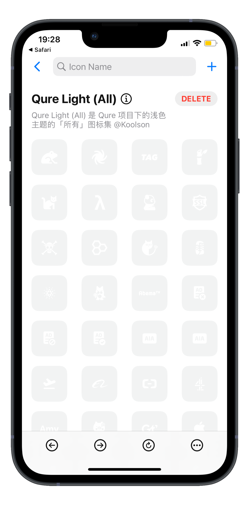
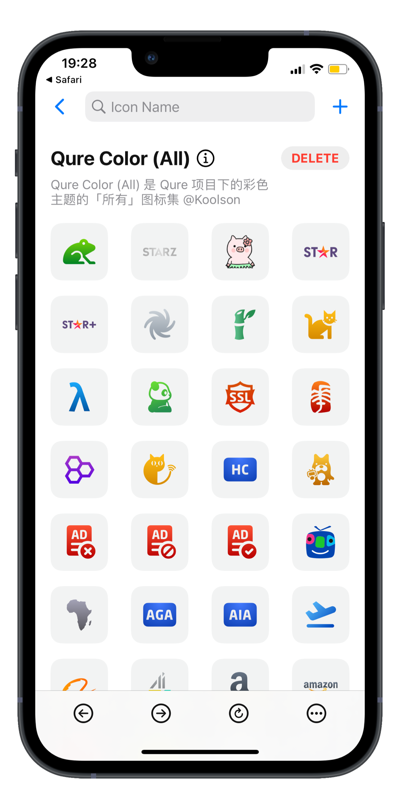
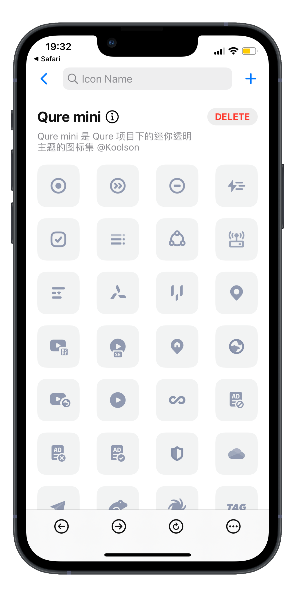
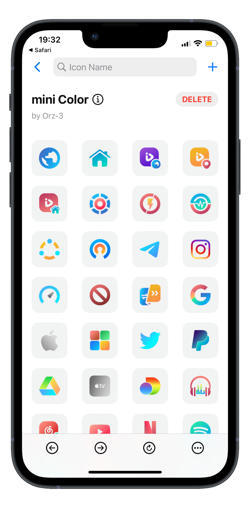

> ⚠️ 仅自用

# 🧰 Tool

> 中国常用域名与中国 IPv4 地址库，让国内流量走国内、走直连，更快、更省电。

## 👀 一眼看懂

| 项目 | 数量 |
| --- | --- |
| 规则集 | 8 个（Egern 和 QX 各一份，内容一致） |
| 模块 | 1 个（哔哩哔哩 · 纯净，Egern 和 QX 各一份） |
| 图标 | 39 个（13 套图标库预览图 + 25 个单个应用图标，都是从别人家搬过来的原图） |
| 域名总数 | 850 条（去重后） |
| GeoIP 库 | 6,575 条 CIDR，约 132KB，覆盖 357,426,983 个中国 IPv4 地址 |
| 自动检查 | 每 4 小时，凌晨 0:00、4:00、8:00…… |

## 📖 目录

- [📦 文件说明](#-文件说明)
- [🧩 模块](#-模块)
- [⚡ 一键添加进软件](#-一键添加进软件)
- [🚀 怎么用](#-怎么用)
- [🔄 自动更新](#-自动更新)
- [❓ 常见问题](#-常见问题)

---

## 📦 文件说明

### 🌐 规则集

| 规则 | 条数 | 说明 | 策略 |
| --- | --- | --- | --- |
| China | 690 | 国内应用 / 网站 + CDN / 后台，Egern DNS 转发 → 国内 | DIRECT |
| Google | 31 | 谷歌搜索、Gmail、YouTube 等 | 谷歌服务 |
| GoogleAds | 24 | 谷歌广告、统计、分析 | reject |
| Apple | 23 | 苹果系统、商店、iCloud | direct |
| Microsoft | 21 | Outlook、微软账号 | 微软服务 |
| SausageMan | 16 | 香肠派对及 TapTap 相关 | direct |
| AI_Part | 45 | Muse、GPT、Claude | 人工智能 |
| GeoIP_CN | 1 | 中国 IP 段（仅 QX 版） | direct |

China.yaml 分两段，第一段是应用 / 网站域名 **553 条**，第二段是 CDN / 后台 / 接口域名 **137 条**，覆盖微信、QQ、淘宝、京东、拼多多、美团、饿了么、抖音、哔哩哔哩、爱奇艺、优酷、知乎、微博、百度、阿里、12306、银行、运营商、政府、快递……还有红果短剧、豆包、DeepSeek、Kimi、腾讯元宝、即梦 AI、剪映、夸克等热门应用。

China 都包括谁？点开看

微信、QQ、淘宝、天猫、京东、拼多多、美团、饿了么、抖音、快手、哔哩哔哩、爱奇艺、优酷、腾讯视频、芒果 TV、知乎、微博、百度、阿里云、12306、携程、滴滴、高德地图、银行、运营商、政府网站、快递，等等。

AI_Part 都包括谁？点开看

- GPT / OpenAI：ChatGPT、Sora 等，19 条
- Claude / Anthropic：Claude 官网、App 等，19 条
- Muse / Meta AI：meta.ai、muse.ai、llama.com 等，7 条

### 🧩 模块

同一个模块 Egern 和 QX 各一份，内容一致、格式不同。脚本单独放 `script/` 文件夹，模块自己去拉，不用手动添加。

- 📺 哔哩哔哩 · 纯净 — Egern：[Bilibili-ADBlock.yaml](https://raw.githubusercontent.com/YuTalk/tool/main/module/egern/Bilibili-ADBlock.yaml)　QX：[Bilibili-ADBlock.snippet](https://raw.githubusercontent.com/YuTalk/tool/main/module/quantumultx/Bilibili-ADBlock.snippet)
  - 去开屏、热词、推荐流广告、视频页广告；「我的」页只留蓝色一排；底部栏只留首页、关注、我的；Egern 版 7 个开关（热词、我的页、动态、评论、优化加载、空降助手、日志等级）。去广告没有总开关，永远开着（按 fmz200 的做法，2026-11-24 重做）

### 📜 脚本

脚本都由我们自己维护，放在顶层 `script/` 文件夹里，模块直接引用我们自己的链接，不引用别人家的脚本链接。kokoryh 的脚本原样复制进来（一个字没改），上游更新后手动同步。

- [bilibili.js](https://raw.githubusercontent.com/YuTalk/tool/main/script/bilibili.js) — 哔哩哔哩 · 纯净模块用的脚本，自己写的，处理开屏、热词、推荐流广告、「我的」页、底部栏、广告接口；开屏、推荐流、广告接口永远拦截，没有开关
- [bilibili.protobuf.request.js](https://raw.githubusercontent.com/YuTalk/tool/main/script/bilibili.protobuf.request.js) / [bilibili.protobuf.response.js](https://raw.githubusercontent.com/YuTalk/tool/main/script/bilibili.protobuf.response.js) — 哔哩哔哩视频页、评论区用的 protobuf 脚本，来自 kokoryh 的 Sparkle，2026-11-24 复制进来（原版，未改）
- [bilibili.json.js](https://raw.githubusercontent.com/YuTalk/tool/main/script/bilibili.json.js) / [webpage.bilibili.js](https://raw.githubusercontent.com/YuTalk/tool/main/script/webpage.bilibili.js) — 哔哩哔哩直播和网页用的脚本，来自 kokoryh 的 Sparkle，2026-11-24 复制进来（原版，未改）

### 🖼️ 图标

图标都放在顶层 `icon/` 文件夹里，都是从别人家搬过来的原图（主要来自 [ddgksf2013/Icon](https://github.com/ddgksf2013/Icon) 和 [Koolson/Qure](https://github.com/Koolson/Qure)）。

**模块正在用的图标：**

| 图标 | 模块 |
| --- | --- |
|  | 哔哩哔哩 · 纯净（Qure 彩色版） |

**13 套图标库（预览图就是原图）：**

蓝色按钮直接加进 QX。绿色按钮是 Egern 的，点开是图标集链接，复制链接后在 Egern 里添加图标库。

#### Qure 系列

**Qure 图标库（黑白）**  

**Qure 图标库（彩色 1）**  

**Qure 图标库（彩色 2）**  

**Qure 图标（mini）**  

#### Orz-3 系列

**Orz-3 图标库（mini style）**  

**Orz-3 图标库（big style）**  

**Orz-3 图标库（mini color）**  

#### 卡通可爱

**泡泡图标**  

**PokemonGo**  

**小猫咪**  

#### 姿势

**姿势图标 1**  

**姿势图标 2**  

#### 手绘

**Semporia**  

> 注意：
> - 不要和已有的 fmz200 哔哩哔哩模块同时开，两个都改同一批接口会打架。
> - QX 版暂不支持精简「我的」页多余入口，那个要 Egern 版才有。
> - 模块要开 MITM，证书要装好、信任开好，不然不生效。

### GeoIpCN.mmdb（6,575 条 CIDR，约 132KB）

只含中国 IPv4，共覆盖 **357,426,983 个地址**，约 132KB。

数据来源（多来源合并去重）：

- 17mon/china_ip_list
- APNIC 中国分配数据（cn|ipv4）
- chnroutes2
- Loyalsoldier/geoip CN 文本（仅 IPv4）
- metowolf/iplist 纯真 CN

> 只含中国段，外国 IP 查不到中国，这是对的 —— GEOIP CN 才能把外国流量送去代理。

---

## 📱 一键跳转到软件

点一下就跳到 App Store，没装就下载，装了就点「打开」：

| 软件 | 跳转 |
| --- | --- |
| 🐿️ Egern（小松鼠，免费 + 内购） | [点我打开 Egern](https://apps.apple.com/us/app/egern/id1616105820) |
| ⚡ Quantumult X（$9.99） | [点我打开 Quantumult X](https://apps.apple.com/us/app/quantumult-x/id1443988620) |

> Egern 和 QX 国区 App Store 搜不到，要用美区 / 港区 Apple ID 才能下载。

---

## ⚡ 一键添加进软件

点下面表格里的链接，就会直接跳进 Egern / QX，问你要不要添加，点确认就加进去了，不用自己复制链接再粘贴。

| 软件 | Egern | Quantumult X |
| --- | --- | --- |
| China |  |  |
| Google |  |  |
| GoogleAds |  |  |
| Apple |  |  |
| Microsoft |  |  |
| SausageMan |  |  |
| AI_Part |  |  |
| GeoIP_CN | 仅 QX 版 |  |

> 注意：
> - Egern 的一键添加是加到**分流**里，China 还要再单独加一次 **DNS 转发 → 国内**，那个不能一键加，得在设置里手动加。
> - 点链接后软件会先弹出来让你确认，策略已经按上面表格填好了，确认就行。
> - 如果点链接没反应，先确认 Egern / QX 已经装好了。

---

## 🚀 怎么用

### 🐿️ Egern

1. **DNS 转发**：设置 → DNS 转发 → 添加规则集，粘贴 China 链接，策略选国内
2. **分流**：设置 → 分流 → 添加规则集，粘贴对应链接，策略按上面表格选
3. **GeoIP 库**：设置 → GeoIP 数据库 → 粘贴 GeoIpCN.mmdb 链接
4. **模块**：工具 → 模块 → + → 粘贴哔哩哔哩 · 纯净的 Egern 版链接
5. **分流留一条**：`GEOIP CN → DIRECT` 放倒数第二，`默认 → 兜底策略` 放最后

> ⚠️ GEOIP CN 一定放倒数第二，别放第一，不然每个域名都要先解析 IP，费电又变慢。

### ⚡ Quantumult X

1. 分流里加远程规则，粘贴上面表格里的 QX 版链接，策略按表格选
2. 模块：重写 → 引用 → 粘贴哔哩哔哩 · 纯净的 QX 版链接
3. 分流留一条：`geoip, cn, direct` 放倒数第二，`final` 放最后
3. QX 不能用自建 .mmdb 库，用它自带的就行

---

## 🔄 自动更新

| 任务 | 频率 |
| --- | --- |
| 仓库检查（全部规则 + GeoIP 库 + README） | 每 4 小时，凌晨 0:00、4:00、8:00…… |

文件名和链接固定不变，只更新内容。新增域名要经过主人同意才加，失效的直接删。

---

## ❓ 常见问题

**Q：外国网站会不会被误判成中国？**
A：不会。库里只装了中国段，外国 IP 返回空，走代理。

**Q：为什么只有 IPv4？**
A：IPv6 关着，用纯 IPv4 更小更快。以后开 IPv6 再换回带 IPv6 的库。

**Q：China.yaml 里的 CDN 域名有什么用？**
A：主域名和 CDN 要一起走国内 DNS，不然图片视频会回外国 IP，慢甚至打不开。

**Q：Egern 和 QX 的文件有什么区别？**
A：内容一样，只是格式不同：Egern 用 `.yaml`，QX 用 `.list`，QX 每条后面都带策略。

---

## 📄 开源协议

MIT License —— 随便用，改了也行。
