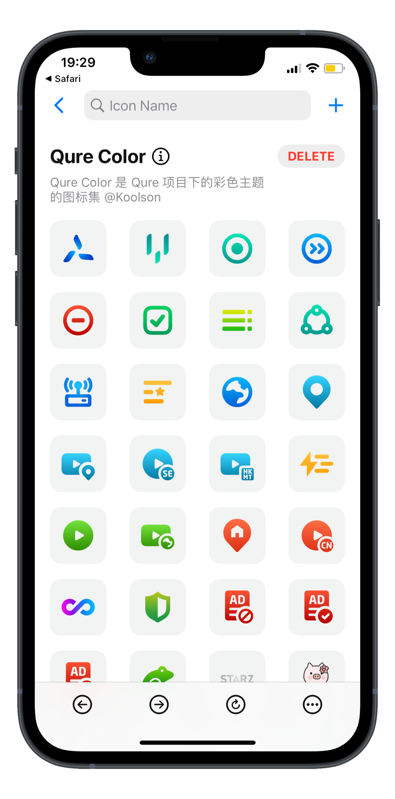
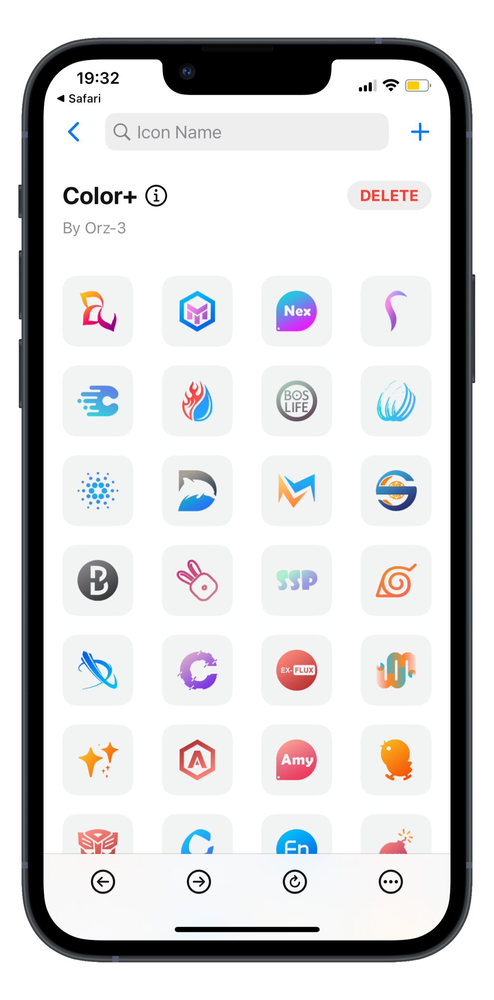
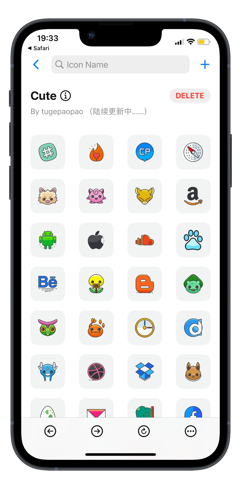
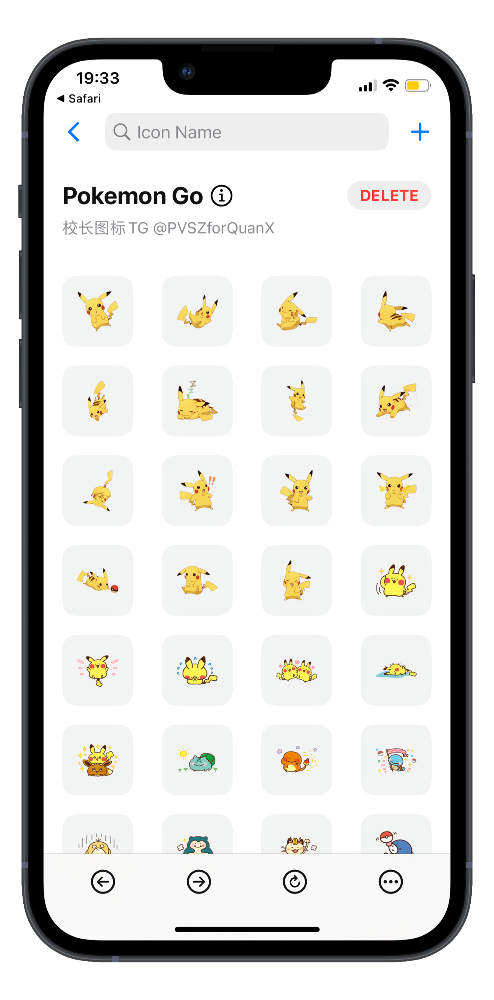
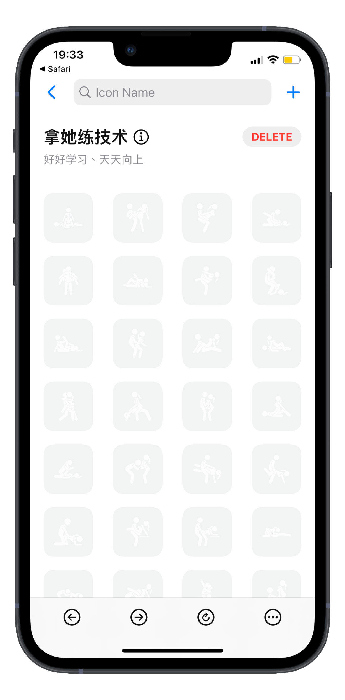
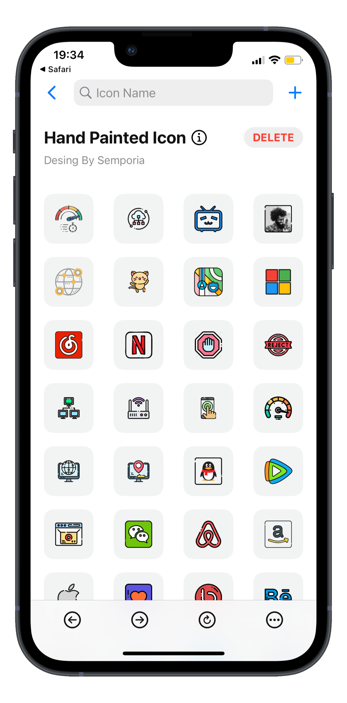

> ⚠️ 本仓库仅供作者个人自用，未采用任何开源协议，不授权他人使用、转载或商用；仓库公开可见仅为便于作者设备拉取规则。内容来源于公开信息，仅供学习参考。

## 📋 GeoIP 库直链

点代码框右上角的复制按钮，粘贴到 Egern 的 GeoIP 数据库设置里。

**IPv4 版**（只含中国 IPv4，6,566 条，约 135KB）：

```
https://raw.githubusercontent.com/YuTalk/tool/main/GeoIpCN.mmdb
```

---

# 🧰 Tool

> 中国常用域名与中国 IPv4 地址库，让国内流量走国内、走直连，更快、更省电。


## 内容预览

| 项目 | 数量 |
| --- | --- |
| 规则集 | 12 个（Egern、QX、Loon 各一份，内容基本一致，Loon 版 3 套多几条） |
| 图标 | 13 个（13 套图标库的预览图，都是从别人家搬过来的原图） |
| 域名总数 | 839 条（去重后，12 套合计 842 条，2 个域名跨套重复） |
| GeoIP 库 | 1 个版本：IPv4 版 6,566 条约 135KB |
| 自动检查 | 每 6 小时，0:00、6:00、12:00、18:00 |

<details>
<summary><b>规则集</b></summary>

qx、egern 两栏里各有一个按钮：qx 的「加进 QX」点一下跳进 QX，问你要不要添加这套规则；egern 的「加进 Egern」点一下打开这套规则的文件，复制链接去 Egern 里粘贴添加（GitHub 不支持直接跳进 Egern）。
| 规则 | 条数 | 说明 | qx | egern |
| --- | --- | --- | --- | --- |
| China | 546 | 国内应用 / 网站 + CDN / 后台 | <a href="https://quantumult.app/x/open-app/add-resource?remote-resource=%7B%22filter_remote%22%3A%5B%22https%3A%2F%2Fraw.githubusercontent.com%2FYuTalk%2Ftool%2Fmain%2Frule%2Fquantumultx%2FChina%2FChina.list%2C%20tag%3DChina%22%5D%7D"></a> | <a href="https://raw.githubusercontent.com/YuTalk/tool/main/rule/egern/China/China.yaml"></a> |
| Google | 31 | 谷歌搜索、Gmail、YouTube 等 | <a href="https://quantumult.app/x/open-app/add-resource?remote-resource=%7B%22filter_remote%22%3A%5B%22https%3A%2F%2Fraw.githubusercontent.com%2FYuTalk%2Ftool%2Fmain%2Frule%2Fquantumultx%2FGoogle%2FGoogle.list%2C%20tag%3DGoogle%22%5D%7D"></a> | <a href="https://raw.githubusercontent.com/YuTalk/tool/main/rule/egern/Google/Google.yaml"></a> |
| Apple | 22 | 苹果系统、商店、iCloud | <a href="https://quantumult.app/x/open-app/add-resource?remote-resource=%7B%22filter_remote%22%3A%5B%22https%3A%2F%2Fraw.githubusercontent.com%2FYuTalk%2Ftool%2Fmain%2Frule%2Fquantumultx%2FApple%2FApple.list%2C%20tag%3DApple%22%5D%7D"></a> | <a href="https://raw.githubusercontent.com/YuTalk/tool/main/rule/egern/Apple/Apple.yaml"></a> |
| Microsoft | 21 | Outlook、微软账号 | <a href="https://quantumult.app/x/open-app/add-resource?remote-resource=%7B%22filter_remote%22%3A%5B%22https%3A%2F%2Fraw.githubusercontent.com%2FYuTalk%2Ftool%2Fmain%2Frule%2Fquantumultx%2FMicrosoft%2FMicrosoft.list%2C%20tag%3DMicrosoft%22%5D%7D"></a> | <a href="https://raw.githubusercontent.com/YuTalk/tool/main/rule/egern/Microsoft/Microsoft.yaml"></a> |
| SausageMan | 15 | 香肠派对及 TapTap 相关 | <a href="https://quantumult.app/x/open-app/add-resource?remote-resource=%7B%22filter_remote%22%3A%5B%22https%3A%2F%2Fraw.githubusercontent.com%2FYuTalk%2Ftool%2Fmain%2Frule%2Fquantumultx%2FSausageMan%2FSausageMan.list%2C%20tag%3DSausageMan%22%5D%7D"></a> | <a href="https://raw.githubusercontent.com/YuTalk/tool/main/rule/egern/SausageMan/SausageMan.yaml"></a> |
| AI_Part | 72 | Muse、GPT、Claude、Grok、Gemini | <a href="https://quantumult.app/x/open-app/add-resource?remote-resource=%7B%22filter_remote%22%3A%5B%22https%3A%2F%2Fraw.githubusercontent.com%2FYuTalk%2Ftool%2Fmain%2Frule%2Fquantumultx%2FAI_Part%2FAI_Part.list%2C%20tag%3DAI_Part%22%5D%7D"></a> | <a href="https://raw.githubusercontent.com/YuTalk/tool/main/rule/egern/AI_Part/AI_Part.yaml"></a> |
| Spotify | 28 | Spotify 音乐及 CDN | <a href="https://quantumult.app/x/open-app/add-resource?remote-resource=%7B%22filter_remote%22%3A%5B%22https%3A%2F%2Fraw.githubusercontent.com%2FYuTalk%2Ftool%2Fmain%2Frule%2Fquantumultx%2FSpotify%2FSpotify.list%2C%20tag%3DSpotify%22%5D%7D"></a> | <a href="https://raw.githubusercontent.com/YuTalk/tool/main/rule/egern/Spotify/Spotify.yaml"></a> |
| TikTok | 32 | 抖音国际版 TikTok | <a href="https://quantumult.app/x/open-app/add-resource?remote-resource=%7B%22filter_remote%22%3A%5B%22https%3A%2F%2Fraw.githubusercontent.com%2FYuTalk%2Ftool%2Fmain%2Frule%2Fquantumultx%2FTikTok%2FTikTok.list%2C%20tag%3DTikTok%22%5D%7D"></a> | <a href="https://raw.githubusercontent.com/YuTalk/tool/main/rule/egern/TikTok/TikTok.yaml"></a> |
| GitHub | 31 | GitHub 及 npm 等 | <a href="https://quantumult.app/x/open-app/add-resource?remote-resource=%7B%22filter_remote%22%3A%5B%22https%3A%2F%2Fraw.githubusercontent.com%2FYuTalk%2Ftool%2Fmain%2Frule%2Fquantumultx%2FGitHub%2FGitHub.list%2C%20tag%3DGitHub%22%5D%7D"></a> | <a href="https://raw.githubusercontent.com/YuTalk/tool/main/rule/egern/GitHub/GitHub.yaml"></a> |
| Speedtest | 9 | 测速（Speedtest、fast.com 等） | <a href="https://quantumult.app/x/open-app/add-resource?remote-resource=%7B%22filter_remote%22%3A%5B%22https%3A%2F%2Fraw.githubusercontent.com%2FYuTalk%2Ftool%2Fmain%2Frule%2Fquantumultx%2FSpeedtest%2FSpeedtest.list%2C%20tag%3DSpeedtest%22%5D%7D"></a> | <a href="https://raw.githubusercontent.com/YuTalk/tool/main/rule/egern/Speedtest/Speedtest.yaml"></a> |
| Telegram | 34 | Telegram 及第三方客户端 | <a href="https://quantumult.app/x/open-app/add-resource?remote-resource=%7B%22filter_remote%22%3A%5B%22https%3A%2F%2Fraw.githubusercontent.com%2FYuTalk%2Ftool%2Fmain%2Frule%2Fquantumultx%2FTelegram%2FTelegram.list%2C%20tag%3DTelegram%22%5D%7D"></a> | <a href="https://raw.githubusercontent.com/YuTalk/tool/main/rule/egern/Telegram/Telegram.yaml"></a> |
| GeoIP_CN | 1 | 中国 IP 段 | <a href="https://quantumult.app/x/open-app/add-resource?remote-resource=%7B%22filter_remote%22%3A%5B%22https%3A%2F%2Fraw.githubusercontent.com%2FYuTalk%2Ftool%2Fmain%2Frule%2Fquantumultx%2FGeoIP_CN%2FGeoIP_CN.list%2C%20tag%3DGeoIP_CN%22%5D%7D"></a> | <a href="https://raw.githubusercontent.com/YuTalk/tool/main/rule/egern/GeoIP_CN/GeoIP_CN.yaml"></a> |
</details>

<details>
<summary><b>图标</b></summary>


13 套图标库，预览图在顶层 `icon/` 里，点图片可以放大看。蓝色按钮直接加进 QX；绿色按钮点了打开图标集 JSON 链接，复制后去 Egern 的图标库里粘贴添加。

#### Qure 系列

**Qure 图标库（黑白）** [](https://quantumult.app/x/open-app/ui?module=gallery&type=icon&action=add&content=%5B%0A%20%20%20%20%22https%3A%2F%2Fgithub.com%2FKoolson%2FQure%2Fraw%2Fmaster%2FOther%2FQureLight-All.json%22%0A%5D) [](https://raw.githubusercontent.com/Koolson/Qure/master/Other/QureLight-All.json)

<a href="https://raw.githubusercontent.com/YuTalk/tool/main/icon/preview-01-qure-light.PNG"></a>

**Qure 图标库（彩色 1）** [](https://quantumult.app/x/open-app/ui?module=gallery&type=icon&action=add&content=%5B%0A%20%20%20%20%22https%3A%2F%2Fgithub.com%2FKoolson%2FQure%2Fraw%2Fmaster%2FOther%2FQureColor-All.json%22%0A%5D) [](https://raw.githubusercontent.com/Koolson/Qure/master/Other/QureColor-All.json)

<a href="https://raw.githubusercontent.com/YuTalk/tool/main/icon/preview-02-qure-color-all.PNG"></a>

**Qure 图标库（彩色 2）** [](https://quantumult.app/x/open-app/ui?module=gallery&type=icon&action=add&content=%5B%0A%20%20%20%20%22https%3A%2F%2Fraw.githubusercontent.com%2FKoolson%2FQure%2Fmaster%2FOther%2FQureColor.json%22%0A%5D) [](https://raw.githubusercontent.com/Koolson/Qure/master/Other/QureColor.json)

<a href="https://raw.githubusercontent.com/YuTalk/tool/main/icon/preview-03-qure-color.PNG"></a>

**Qure 图标（mini）** [](https://quantumult.app/x/open-app/ui?module=gallery&type=icon&action=add&content=%5B%0A%20%20%20%20%22https%3A%2F%2Fraw.githubusercontent.com%2FKoolson%2FQure%2Fmaster%2FOther%2FQuremini.json%22%0A%5D) [](https://raw.githubusercontent.com/Koolson/Qure/master/Other/Quremini.json)

<a href="https://raw.githubusercontent.com/YuTalk/tool/main/icon/preview-04-qure-mini.PNG"></a>

#### Orz-3 系列

**Orz-3 图标库（mini style）** [](https://quantumult.app/x/open-app/ui?module=gallery&type=icon&action=add&content=%5B%0A%20%20%20%20%22https%3A%2F%2Fgithub.com%2FOrz-3%2Fmini%2Fraw%2Fmaster%2Fmini.json%22%0A%5D) [](https://raw.githubusercontent.com/Orz-3/mini/master/mini.json)

<a href="https://raw.githubusercontent.com/YuTalk/tool/main/icon/preview-05-orz3-mini.PNG"></a>

**Orz-3 图标库（big style）** [](https://quantumult.app/x/open-app/ui?module=gallery&type=icon&action=add&content=%5B%0A%20%20%20%20%22https%3A%2F%2Fraw.githubusercontent.com%2FOrz-3%2Fmini%2Fmaster%2FColor%2B.json%22%0A%5D) [](https://raw.githubusercontent.com/Orz-3/mini/master/Color+.json)

<a href="https://raw.githubusercontent.com/YuTalk/tool/main/icon/preview-06-orz3-big.PNG"></a>

**Orz-3 图标库（mini color）** [](https://quantumult.app/x/open-app/ui?module=gallery&type=icon&action=add&content=%5B%0A%20%20%20%20%22https%3A%2F%2Fraw.githubusercontent.com%2FOrz-3%2Fmini%2Fmaster%2FminiColor.json%22%0A%5D) [](https://raw.githubusercontent.com/Orz-3/mini/master/miniColor.json)

<a href="https://raw.githubusercontent.com/YuTalk/tool/main/icon/preview-07-orz3-mini-color.PNG"></a>

#### 卡通可爱

**泡泡图标** [](https://quantumult.app/x/open-app/ui?module=gallery&type=icon&action=add&content=%5B%0A%20%20%20%20%22https%3A%2F%2Fraw.githubusercontent.com%2Ftugepaopao%2FImage-Storage%2Fmaster%2Fother%2FCute.json%22%0A%5D) [](https://raw.githubusercontent.com/tugepaopao/Image-Storage/master/other/Cute.json)

<a href="https://raw.githubusercontent.com/YuTalk/tool/main/icon/preview-08-cute.PNG"></a>

**PokemonGo** [](https://quantumult.app/x/open-app/ui?module=gallery&type=icon&action=add&content=%5B%0A%20%20%20%20%22https%3A%2F%2Fraw.githubusercontent.com%2Fshoujiqiyuan%2FPokemonGOforQuanX%2Fmaster%2FPokemonGo.json%22%0A%5D) [](https://raw.githubusercontent.com/shoujiqiyuan/PokemonGOforQuanX/master/PokemonGo.json)

<a href="https://raw.githubusercontent.com/YuTalk/tool/main/icon/preview-09-pokemongo.PNG"></a>

**小猫咪** [](https://quantumult.app/x/open-app/ui?module=gallery&type=icon&action=add&content=%5B%0A%20%20%20%20%22https%3A%2F%2Fraw.githubusercontent.com%2FYuanxsxs%2FQtumultX%2Fmaster%2FIcon%2FCatcat.json%22%0A%5D) [](https://raw.githubusercontent.com/Yuanxsxs/QtumultX/master/Icon/Catcat.json)

<a href="https://raw.githubusercontent.com/YuTalk/tool/main/icon/preview-10-catcat.PNG"></a>

#### 姿势

**姿势图标 1** [](https://quantumult.app/x/open-app/ui?module=gallery&type=icon&action=add&content=%5B%0A%20%20%20%20%22https%3A%2F%2Fgithub.com%2FLovedGM%2FQuantumult-X-TuBiao%2Fraw%2Fmain%2Fzishi.json%22%0A%5D) [](https://raw.githubusercontent.com/LovedGM/Quantumult-X-TuBiao/main/zishi.json)

<a href="https://raw.githubusercontent.com/YuTalk/tool/main/icon/preview-11-zishi.PNG"></a>

**姿势图标 2** [](https://quantumult.app/x/open-app/ui?module=gallery&type=icon&action=add&content=%5B%0A%20%20%20%20%22https%3A%2F%2Fraw.githubusercontent.com%2FLovedGM%2FQuantumult-X-TuBiao%2Fmain%2Fzishi-cs.json%22%0A%5D) [](https://raw.githubusercontent.com/LovedGM/Quantumult-X-TuBiao/main/zishi-cs.json)

<a href="https://raw.githubusercontent.com/YuTalk/tool/main/icon/preview-12-zishi-cs.PNG"></a>

#### 手绘

**Semporia** [](https://quantumult.app/x/open-app/ui?module=gallery&type=icon&action=add&content=%5B%0A%20%20%20%20%22https%3A%2F%2Fraw.githubusercontent.com%2FSemporia%2FHand-Painted-icon%2Fmaster%2FSemporia.json%22%0A%5D) [](https://raw.githubusercontent.com/Semporia/Hand-Painted-icon/master/Semporia.json)

<a href="https://raw.githubusercontent.com/YuTalk/tool/main/icon/preview-13-semporia.PNG"></a>

---

</details>
<details>
<summary><b>文件说明</b></summary>

每套规则都放在自己的文件夹里（比如 `rule/egern/China/`），点进文件夹能看到这套规则的说明页。Loon 版在 `rule/loon/` 里，Spotify 29 条、TikTok 33 条、Telegram 44 条，其余一样。点开每条规则，看里面包含哪些应用。

<details>
<summary>China（546 条）</summary>

应用 / 网站（438 条）：微信、QQ、QQ邮箱、QQ音乐、腾讯视频、腾讯微云、腾讯文档、腾讯会议、微信支付、财付通、腾讯应用宝、Foxmail、搜搜、起点中文网、红袖添香、起点读书、阅文集团、腾讯元宝、腾讯、淘宝、天猫、1688、闲鱼、支付宝、阿里巴巴、阿里云、阿里云 DNS、速卖通、钉钉、饿了么、高德地图、优酷、土豆网、虾米音乐、万网、夸克、百度、百度地图、百度贴吧、百度智能云、百度短链接、百度糯米、hao123、爱奇艺、千千音乐、抖音、今日头条、今日头条号、火山小视频、火山直播、飞聊、飞书、豆包、剪映、即梦AI、红果短剧、悟空问答、字节跳动、网易、网易邮箱、网易云音乐、网易云、有道、LOFTER、网易易盾、网易考拉、京东、京东支付、拍拍网、美团、美团外卖、大众点评、小米、金山、WPS、金山词霸、金山云、多看阅读、快手、哔哩哔哩、哔哩哔哩游戏、12306、1号店、Abercrombie & Fitch、BootCSS、DeepSeek、EMS、Element Plus、FIR 应用分发、Gitee、HelpShift、Hollister、IPIP、IT168、IT之家、Kimi、KnewOne、Mob、OneDNS、Outlook、PPTV、Snapdrop、StartSSL、Steam、Steam（完美世界）、Tebex、UC浏览器、Weico、YY直播、Zealer、realme、vivo、xip.io、一下科技、一加、下厨房、东方网、中信银行、中华网、中国农业银行、中国国际广播电台、中国天气、中国日报、中国气象局、中国电信、中国移动、中国网、中国联通、中国邮政、中国邮政储蓄银行、中国银联、中央人民广播电台、中搜、中文域名（.中国）、中文域名（.公司）、中文域名（.网络）、中通快递、乐居、书迷楼、人人影视、人人影视字幕组、什么值得买、保利威、全民直播、凤凰网、加网、华军软件园、南方周末、博客园、印象笔记、去哪儿、又拍云、和风天气、喜茶、喜马拉雅、嘀哩嘀哩、圆通速递、坚果云、墨迹天气、多玩游戏、天天美剧、天气、天气网、天涯社区、天眼查、太合音乐、央视网、好奇心日报、威锋网、字幕组、宜搜、小红书、少数派、幕布、开源中国、开课吧、微博、微店、微软、快递100、思否、我买网、战旗直播、房天下、所有 .cn 域名、招商银行、拼多多、搜库、搜狐、搜狗、摩拜单车、斗鱼、新华网、新浪、新浪云、易宝支付、星巴克、智联招聘、极验、永硕E盘、海底捞、滴滴出行、澎湃新闻、火车票网、猫眼电影、环球网、瑞幸咖啡、瓜子二手车、申通快递、电影天堂、界面新闻、看看、知乎、秀米、科大讯飞、秒拍、简书、糗事百科、索尼、美丽说、美图、美拍、联想、聚美优品、肯德基、腾讯 DNSPod、色影无忌、芒果TV、花椒直播、苏宁易购、荔枝FM、荣耀、菜鸟教程、落网、蓝奏云、蓝点网、蘑菇街、虎扑、虎牙直播、观察者网、豆瓣、豌豆荚、赶集网、车168、迅雷、途牛、酷我音乐、酷狗音乐、铁血网、雪球、音悦台、韵达快递、顺丰速运、魅族、麦当劳。

CDN / 后台 / 接口（108 条）：1号店图片、CloudXNS、QQ/微信头像 CDN、QQ头像/图片、YY静态、中国联通沃商店云、亚马逊图片、京东云、京东图片 CDN、今日头条 API、今日头条 CDN、今日头条云、今日头条图片、优酷图片、凤凰网图片、友盟云、咪咕云、咪咕视频、哔哩哔哩、哔哩哔哩 API、哔哩哔哩视频、天气网静态、央视网图片、字幕组 API、字节跳动、字节跳动 API、字节跳动 CDN、字节跳动 DNS、字节跳动图片、字节跳动静态、小米图片、微博 CDN、抖音 CDN、抖音图片、抖音视频点播、抖音静态、搜房网图片、搜狗 CDN、斗鱼 CDN、新浪图片、淘宝 CDN、淘宝/天猫 CDN、淘宝缓存、爱奇艺图片、百度图片、百度智能云对象存储、百度静态、百度静态 CDN、知乎图片、简书 API、腾讯云、腾讯云 CDN、腾讯图片 CDN、蘑菇街 CDN、虎嗅网 CDN、赶集网静态、迅雷 CDN、途牛 CDN、阿里云、阿里云 CDN、阿里图片 CDN、饿了么 CDN。

未识别的域名：13th.tech、71.am、8686c.com、algocasts.io、allawnfs.com、allawno.com、allawntech.com、asklink.com、baomitu.com、chaipip.com、chinaplay.store、cn163.net、cnmstl.net、dhrest.com、fantasy.tv、feelgood.cn、frdic.com、fresh-ideas.cc、ghpym.com、go2map.com、godic.net、gwdang.com、gzlzfm.com、haibian.com、hitv.com、hrtsea.com、id6.me、igamecj.com、im9.com、ixdzs.com、jomodns.com、ksosoft.com、kspkg.com、laomo.me、lemicp.com、letitfly.me、lxdns.com、moke.com、mpyit.com、nruan.com、ourdvs.com、paragon.com、pdfwifi.com、qbox.me、qin.io、qy.net、repaik.com、ruguoapp.com、sandai.net、simplecd.me、snwx.com、tencentmind.com、th-sjy.com、tianyaui.com、tietuku.com、tmiaoo.com、udache.com、uxengine.net、xdrig.com、xiaojukeji.com、xslb.net、yach.me、zhangzishi.cc、zhenguanyu.biz、zhenguanyu.com、zhuihd.com、hc-cdn.com、mmstat.com、smtcdns.com、smtcdns.net、00cdn.com、71edge.com、88cdn.com、appsimg.com、cdnmama.com、chuimg.com、dxycdn.com、edgesrv.com、fengkongcloud.com、geilicdn.com、jmstatic.com、kanimg.com、msstatic.com、p2cdn.com、st.dl.bscstorage.net、st.dl.eccdnx.com、st.dl.pinyuncloud.com、wscdns.com、xhscdn.com、xmcdn.com、ydstatic.com、yunjiasu-cdn.net、yximgs.com、zjcdn.com。

</details>

<details>
<summary>Google（31 条）</summary>

谷歌搜索、Gmail、YouTube、YouTube Music、Google云端硬盘、Google文档、Google地图、Google Play、Google翻译、Google学术、Google新闻、Google相册、Google日历、Google Meet、Gemini、谷歌账号、谷歌API、谷歌图片、谷歌用户内容、谷歌静态、YouTube视频、YouTube图片。

</details>

<details>
<summary>Apple（22 条）</summary>

苹果、iCloud、App Store、iTunes、Apple Music、Apple TV、苹果支持、苹果开发者、CloudKit、iCloud内容、苹果静态、苹果CDN、苹果图片、苹果DNS。

</details>

<details>
<summary>Microsoft（21 条）</summary>

微软、Outlook、Hotmail、Office、Office 365、Microsoft 365、OneDrive、Windows、Windows更新、微软在线服务、SharePoint、MSN、必应搜索、Azure、微软账号、微软支持、微软学习、微软Live。

</details>

<details>
<summary>SausageMan（15 条）</summary>

香肠派对、TapTap、TapTap直播SDK、心动网络、腾讯云。

未识别的域名：my-imcloud.com、imcloud.com。

</details>

<details>
<summary>AI_Part（72 条）</summary>

ChatGPT、Sora、OpenAI、Claude、Anthropic、MCP（模型上下文协议）、Meta AI、Muse、Llama、Meta、Grok、Grokipedia、xAI、Gemini、Bard、Google AI、Google AI Studio、Google Cloud AI、Google MakerSuite、Google生成式AI、DeepMind、Vertex AI、Google。

未识别的域名：crixet.com。

</details>

<details>
<summary>Spotify（28 条）</summary>

Spotify（主站、音频 CDN、图片 CDN、短链接 spoti.fi、招聘、新闻、设计、图表、Spotify Codes、Spotify for Brands）。

另外还有进程名 spotify、2 个服务器 IP（104.154.127.126、35.186.224.47）、通配符 Spotify*。Loon 版 29 条。

</details>

<details>
<summary>TikTok（32 条）</summary>

TikTok、TikTok Music、Musical.ly、MarsCode、Trae、字节跳动。

另外还有进程名 tiktok、tiktokcdn、通配符 TikTok*。Loon 版 33 条。

</details>

<details>
<summary>GitHub（31 条）</summary>

GitHub、GitHub Copilot、GitHub Pages、GitHub.dev、Atom、Dependabot、npm、GitHub Container Registry、GitHub Status、GitHub Universe、GitHub社区、GitHub Blog、GitHub商店、开源指南、RawGit、RawGitHub、GitHub App、GitHub Hackathon、GitHub Next、GitHub Preview、My Octocat。

另外还有进程名 github。

</details>

<details>
<summary>Speedtest（9 条）</summary>

Speedtest、Speedtest Custom、Fast.com、Cloudflare测速、Ookla。

另外还有进程名 speedtest、通配符 SpeedTest*。

未识别的域名：speed.dler.io。

</details>

<details>
<summary>Telegram（34 条）</summary>

Telegram、Telegraph、Telegram Desktop、Telegram下载、Swiftgram、Telega、Telegram Comments、Telegram Contest、Telegram Quiz、Telesco.pe。

另外还有进程名 nicegram、6 个 IPv4 段、4 个 IPv6 段。Loon 版 44 条。

未识别的域名：mbrx.app、stel.com、usercontent.dev、api.imem.app。

</details>

<details>
<summary>GeoIP_CN（1 条）</summary>

没有应用，只有一条 GEOIP CN 规则（中国 IP 段）。

</details>

</details>

<details>
<summary><b>自动更新</b></summary>


| 任务 | 频率 |
| --- | --- |
| 仓库检查（全部规则 + GeoIP 库 + README） | 每 6 小时，0:00、6:00、12:00、18:00 |

这个检查不是仓库自带的 GitHub Actions，仓库里没有 .github/workflows，是外部定时任务在跑，有变化才推到仓库。

每次检查做四件事：

1. **规则**：China 从 ChinaDomain.list 和 geolocation-cn.yaml 拉最新源，合并去重；其他 6 套检查有没有失效域名（已停用、无法解析、服务已下线）。Egern 版和 QX 版同步改。
2. **GeoIP 库**：从 8 个来源拉最新 IP 段，合并去重后重建 GeoIpCN.mmdb（IPv4 版），验证通过才推。
3. **README**：检查里面的链接和条数是不是还对得上仓库现状，对不上就改对。
4. **图标**：13 张预览图都在不在，链接能不能打开。

文件名和链接固定不变，只更新内容。新增域名要经过主人同意才加，失效的直接删。每次有变化都会发邮件通知，没变化就不发。

---

</details>

### GeoIP 库

**IPv4 版：GeoIpCN.mmdb（6,566 条 CIDR，约 135KB）**

只含中国 IPv4，共覆盖 **357,421,607 个地址**，约 135KB。

这是干什么的？代理软件拿到一个 IP 地址后，要判断这个 IP 是中国的还是外国的，才能决定走直连还是走代理，这个判断就靠 GeoIP 库。库里只装了中国段，外国 IP 查不到中国，返回空，就走代理；中国 IP 查得到，就走直连。所以库里没有外国段是正常的，不是缺数据。

数据来源（8 个来源合并去重，每个来源单独拿出来都不全，合起来才全）：

- 17mon/china_ip_list：国内常用的中国 IP 列表
- APNIC 中国分配数据（cn|ipv4）：亚太互联网络信息中心分配给中国的 IP 段，最权威
- chnroutes2：开源的中国路由表
- Loyalsoldier/geoip CN 文本：Loyalsoldier 维护的中国 IP 文本（IPv4）
- metowolf/iplist 纯真 CN：纯真 IP 库的中国段
- gaoyifan/china-operator-ip：三大运营商 IP 段（IPv4）
- clang/Clang.cn：中国 IP 列表（IPv4）
- missuo/ASN-China：中国 IP 列表（IPv4）

怎么验证？223.5.5.5（阿里 DNS）、119.29.29.29（腾讯 DNS）、114.114.114.114 查出来必须是 CN；8.8.8.8（谷歌 DNS）、1.1.1.1 查出来必须不是 CN。

> 只含中国段，外国 IP 查不到中国，这是对的 —— GEOIP CN 才能把外国流量送去代理。

---


## 📄 使用说明

本仓库仅供作者个人自用，未采用任何开源协议，不授权他人使用、转载或商用；仓库公开可见仅为便于作者设备拉取规则。里面的规则和 GeoIP 库数据来自互联网公开信息（17mon、APNIC、Loyalsoldier 等 8 个上游），图标是从别人家搬来的原图，各有各的许可，请勿直接商用或转载。

---

## 🔗 相关网站

平时找模块、规则用得上的几个站：

| 网站 | 是干什么的 |
| --- | --- |
| [Egern Hub](https://egern.pages.dev) | Egern 官方站，模块、规则与文档 |
| [松果库](https://nutrepo.com) | Egern、Surge、Loon、QX、Stash 的模块中心 |
| [yfamily](https://yfamilys.com) | 代理工具的配置、模块、插件与分流规则 |
| [ios_rule_script](https://github.com/blackmatrix7/ios_rule_script/tree/master) | blackmatrix7 的 iOS 规则库，本仓库 5 套规则的上游 |
| [墨魚手記](https://ddgksf2013.top) | 个人资源索引：影视、动漫、下载、工具、QX 脚本 |

