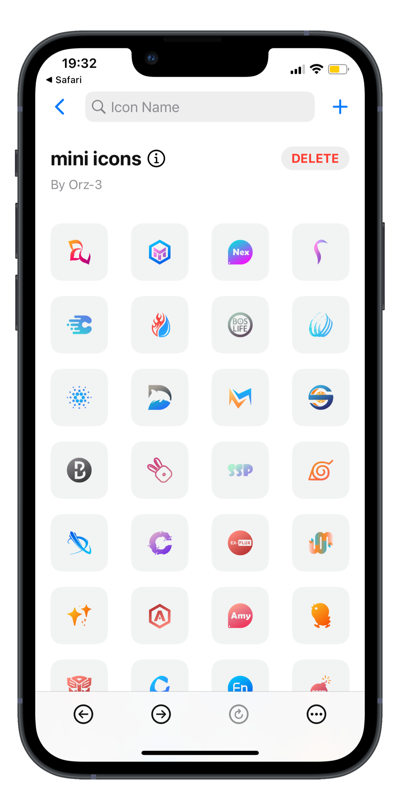

> ⚠️ 本仓库仅供作者个人自用，未采用任何开源协议，不授权他人使用、转载或商用；仓库公开可见仅为便于作者设备拉取规则。内容来源于公开信息，仅供学习参考。

## 📋 GeoIP 库直链

点代码框右上角的复制按钮，粘贴到 Egern 的 GeoIP 数据库设置里。

**IPv4 版**（只含中国 IPv4，6,566 条，约 132KB）：

```
https://raw.githubusercontent.com/YuTalk/tool/main/GeoIpCN.mmdb
```

**IPv4+IPv6 版**（IPv4 6,604 条 + IPv6 2,072 条，约 241KB）：

```
https://raw.githubusercontent.com/YuTalk/tool/main/GeoIpCN-v6.mmdb
```

---

# 🧰 Tool

> 中国常用域名与中国 IPv4/IPv6 地址库，让国内流量走国内、走直连，更快、更省电。


## 内容预览

| 项目 | 数量 |
| --- | --- |
| 规则集 | 12 个（Egern、QX、Loon 各一份，内容基本一致，Loon 版 3 套多几条） |
| 图标 | 13 个（13 套图标库的预览图，都是从别人家搬过来的原图） |
| 域名总数 | 839 条（去重后，12 套合计 842 条，2 个域名跨套重复） |
| GeoIP 库 | 2 个版本：IPv4 版 6,566 条约 132KB；IPv4+IPv6 版 8,676 条约 241KB |
| 自动检查 | 每 6 小时，0:00、6:00、12:00、18:00 |

<details>
<summary><b>规则集</b></summary>

每行最后面有两个按钮：蓝色点一下跳进 QX，问你要不要添加这套规则；绿色点一下跳进 Egern，打开添加规则的页面，类型、链接、策略都填好了，确认就能加。

| 规则 | 条数 | 说明 | 一键添加 |
| --- | --- | --- | --- |
| China | 546 | 国内应用 / 网站 + CDN / 后台 | <a href="https://quantumult.app/x/open-app/add-resource?remote-resource=%7B%22filter_remote%22%3A%5B%22https%3A%2F%2Fraw.githubusercontent.com%2FYuTalk%2Ftool%2Fmain%2Frule%2Fquantumultx%2FChina%2FChina.list%2C%20tag%3DChina%22%5D%7D"></a><br><a href="egern:/rules/new?type=rule_set&match=https%3A%2F%2Fraw.githubusercontent.com%2FYuTalk%2Ftool%2Fmain%2Frule%2Fegern%2FChina%2FChina.yaml&policy=DIRECT"></a> |
| Google | 31 | 谷歌搜索、Gmail、YouTube 等 | <a href="https://quantumult.app/x/open-app/add-resource?remote-resource=%7B%22filter_remote%22%3A%5B%22https%3A%2F%2Fraw.githubusercontent.com%2FYuTalk%2Ftool%2Fmain%2Frule%2Fquantumultx%2FGoogle%2FGoogle.list%2C%20tag%3DGoogle%22%5D%7D"></a><br><a href="egern:/rules/new?type=rule_set&match=https%3A%2F%2Fraw.githubusercontent.com%2FYuTalk%2Ftool%2Fmain%2Frule%2Fegern%2FGoogle%2FGoogle.yaml&policy=%E8%B0%B7%E6%AD%8C%E6%9C%8D%E5%8A%A1"></a> |
| Apple | 22 | 苹果系统、商店、iCloud | <a href="https://quantumult.app/x/open-app/add-resource?remote-resource=%7B%22filter_remote%22%3A%5B%22https%3A%2F%2Fraw.githubusercontent.com%2FYuTalk%2Ftool%2Fmain%2Frule%2Fquantumultx%2FApple%2FApple.list%2C%20tag%3DApple%22%5D%7D"></a><br><a href="egern:/rules/new?type=rule_set&match=https%3A%2F%2Fraw.githubusercontent.com%2FYuTalk%2Ftool%2Fmain%2Frule%2Fegern%2FApple%2FApple.yaml&policy=DIRECT"></a> |
| Microsoft | 21 | Outlook、微软账号 | <a href="https://quantumult.app/x/open-app/add-resource?remote-resource=%7B%22filter_remote%22%3A%5B%22https%3A%2F%2Fraw.githubusercontent.com%2FYuTalk%2Ftool%2Fmain%2Frule%2Fquantumultx%2FMicrosoft%2FMicrosoft.list%2C%20tag%3DMicrosoft%22%5D%7D"></a><br><a href="egern:/rules/new?type=rule_set&match=https%3A%2F%2Fraw.githubusercontent.com%2FYuTalk%2Ftool%2Fmain%2Frule%2Fegern%2FMicrosoft%2FMicrosoft.yaml&policy=DIRECT"></a> |
| SausageMan | 15 | 香肠派对及 TapTap 相关 | <a href="https://quantumult.app/x/open-app/add-resource?remote-resource=%7B%22filter_remote%22%3A%5B%22https%3A%2F%2Fraw.githubusercontent.com%2FYuTalk%2Ftool%2Fmain%2Frule%2Fquantumultx%2FSausageMan%2FSausageMan.list%2C%20tag%3DSausageMan%22%5D%7D"></a><br><a href="egern:/rules/new?type=rule_set&match=https%3A%2F%2Fraw.githubusercontent.com%2FYuTalk%2Ftool%2Fmain%2Frule%2Fegern%2FSausageMan%2FSausageMan.yaml&policy=DIRECT"></a> |
| AI_Part | 72 | Muse、GPT、Claude、Grok、Gemini | <a href="https://quantumult.app/x/open-app/add-resource?remote-resource=%7B%22filter_remote%22%3A%5B%22https%3A%2F%2Fraw.githubusercontent.com%2FYuTalk%2Ftool%2Fmain%2Frule%2Fquantumultx%2FAI_Part%2FAI_Part.list%2C%20tag%3DAI_Part%22%5D%7D"></a><br><a href="egern:/rules/new?type=rule_set&match=https%3A%2F%2Fraw.githubusercontent.com%2FYuTalk%2Ftool%2Fmain%2Frule%2Fegern%2FAI_Part%2FAI_Part.yaml&policy=%E4%BA%BA%E5%B7%A5%E6%99%BA%E8%83%BD"></a> |
| Spotify | 28 | Spotify 音乐及 CDN | <a href="https://quantumult.app/x/open-app/add-resource?remote-resource=%7B%22filter_remote%22%3A%5B%22https%3A%2F%2Fraw.githubusercontent.com%2FYuTalk%2Ftool%2Fmain%2Frule%2Fquantumultx%2FSpotify%2FSpotify.list%2C%20tag%3DSpotify%22%5D%7D"></a><br><a href="egern:/rules/new?type=rule_set&match=https%3A%2F%2Fraw.githubusercontent.com%2FYuTalk%2Ftool%2Fmain%2Frule%2Fegern%2FSpotify%2FSpotify.yaml&policy=Spotify"></a> |
| TikTok | 32 | 抖音国际版 TikTok | <a href="https://quantumult.app/x/open-app/add-resource?remote-resource=%7B%22filter_remote%22%3A%5B%22https%3A%2F%2Fraw.githubusercontent.com%2FYuTalk%2Ftool%2Fmain%2Frule%2Fquantumultx%2FTikTok%2FTikTok.list%2C%20tag%3DTikTok%22%5D%7D"></a><br><a href="egern:/rules/new?type=rule_set&match=https%3A%2F%2Fraw.githubusercontent.com%2FYuTalk%2Ftool%2Fmain%2Frule%2Fegern%2FTikTok%2FTikTok.yaml&policy=TikTok"></a> |
| GitHub | 31 | GitHub 及 npm 等 | <a href="https://quantumult.app/x/open-app/add-resource?remote-resource=%7B%22filter_remote%22%3A%5B%22https%3A%2F%2Fraw.githubusercontent.com%2FYuTalk%2Ftool%2Fmain%2Frule%2Fquantumultx%2FGitHub%2FGitHub.list%2C%20tag%3DGitHub%22%5D%7D"></a><br><a href="egern:/rules/new?type=rule_set&match=https%3A%2F%2Fraw.githubusercontent.com%2FYuTalk%2Ftool%2Fmain%2Frule%2Fegern%2FGitHub%2FGitHub.yaml&policy=GitHub"></a> |
| Speedtest | 9 | 测速（Speedtest、fast.com 等） | <a href="https://quantumult.app/x/open-app/add-resource?remote-resource=%7B%22filter_remote%22%3A%5B%22https%3A%2F%2Fraw.githubusercontent.com%2FYuTalk%2Ftool%2Fmain%2Frule%2Fquantumultx%2FSpeedtest%2FSpeedtest.list%2C%20tag%3DSpeedtest%22%5D%7D"></a><br><a href="egern:/rules/new?type=rule_set&match=https%3A%2F%2Fraw.githubusercontent.com%2FYuTalk%2Ftool%2Fmain%2Frule%2Fegern%2FSpeedtest%2FSpeedtest.yaml&policy=SpeedTest"></a> |
| Telegram | 34 | Telegram 及第三方客户端 | <a href="https://quantumult.app/x/open-app/add-resource?remote-resource=%7B%22filter_remote%22%3A%5B%22https%3A%2F%2Fraw.githubusercontent.com%2FYuTalk%2Ftool%2Fmain%2Frule%2Fquantumultx%2FTelegram%2FTelegram.list%2C%20tag%3DTelegram%22%5D%7D"></a><br><a href="egern:/rules/new?type=rule_set&match=https%3A%2F%2Fraw.githubusercontent.com%2FYuTalk%2Ftool%2Fmain%2Frule%2Fegern%2FTelegram%2FTelegram.yaml&policy=Telegram"></a> |
| GeoIP_CN | 1 | 中国 IP 段 | <a href="https://quantumult.app/x/open-app/add-resource?remote-resource=%7B%22filter_remote%22%3A%5B%22https%3A%2F%2Fraw.githubusercontent.com%2FYuTalk%2Ftool%2Fmain%2Frule%2Fquantumultx%2FGeoIP_CN%2FGeoIP_CN.list%2C%20tag%3DGeoIP_CN%22%5D%7D"></a><br><a href="egern:/rules/new?type=rule_set&match=https%3A%2F%2Fraw.githubusercontent.com%2FYuTalk%2Ftool%2Fmain%2Frule%2Fegern%2FGeoIP_CN%2FGeoIP_CN.yaml&policy=DIRECT"></a> |

</details>

<details>
<summary><b>图标</b></summary>


图标都放在顶层 `icon/` 文件夹里，都是从别人家搬过来的原图（主要来自 [ddgksf2013/Icon](https://github.com/ddgksf2013/Icon) 和 [Koolson/Qure](https://github.com/Koolson/Qure)）。文件夹里现在只有 13 张预览图（preview-01 到 preview-13），单个应用图标已经删了，只留预览图给你看效果。

**13 套图标库（预览图就是原图，点图片可以放大看）：**

蓝色按钮直接加进 QX，点了就跳进 QX 问你要不要添加。绿色按钮是 Egern 的，Egern 没有一键导入图标的功能，点了打开的是图标集 JSON 链接，复制链接后去 Egern 的图标库里粘贴添加。

五组风格：Qure 系列是简洁线条风（黑白、彩色、mini 三种）；Orz-3 系列是圆润彩色风；卡通可爱组是泡泡、宝可梦、小猫咪；姿势组是人物姿势图标；手绘组是 Semporia 的手绘风。

#### Qure 系列

**Qure 图标库（黑白）** [](https://quantumult.app/x/open-app/ui?module=gallery&type=icon&action=add&content=%5B%0A%20%20%20%20%22https%3A%2F%2Fgithub.com%2FKoolson%2FQure%2Fraw%2Fmaster%2FOther%2FQureLight-All.json%22%0A%5D) [](https://raw.githubusercontent.com/Koolson/Qure/master/Other/QureLight-All.json)

<a href="https://raw.githubusercontent.com/YuTalk/tool/main/icon/preview-01-qure-light.PNG"></a>

**Qure 图标库（彩色 1）** [](https://quantumult.app/x/open-app/ui?module=gallery&type=icon&action=add&content=%5B%0A%20%20%20%20%22https%3A%2F%2Fgithub.com%2FKoolson%2FQure%2Fraw%2Fmaster%2FOther%2FQureColor-All.json%22%0A%5D) [](https://raw.githubusercontent.com/Koolson/Qure/master/Other/QureColor-All.json)

<a href="https://raw.githubusercontent.com/YuTalk/tool/main/icon/preview-02-qure-color-all.PNG"></a>

**Qure 图标库（彩色 2）** [](https://quantumult.app/x/open-app/ui?module=gallery&type=icon&action=add&content=%5B%0A%20%20%20%20%22https%3A%2F%2Fraw.githubusercontent.com%2FKoolson%2FQure%2Fmaster%2FOther%2FQureColor.json%22%0A%5D) [](https://raw.githubusercontent.com/Koolson/Qure/master/Other/QureColor.json)

<a href="https://raw.githubusercontent.com/YuTalk/tool/main/icon/preview-03-qure-color.PNG"></a>

**Qure 图标（mini）** [](https://quantumult.app/x/open-app/ui?module=gallery&type=icon&action=add&content=%5B%0A%20%20%20%20%22https%3A%2F%2Fraw.githubusercontent.com%2FKoolson%2FQure%2Fmaster%2FOther%2FQuremini.json%22%0A%5D) [](https://raw.githubusercontent.com/Koolson/Qure/master/Other/Quremini.json)

<a href="https://raw.githubusercontent.com/YuTalk/tool/main/icon/preview-04-qure-mini.PNG"></a>

#### Orz-3 系列

**Orz-3 图标库（mini style）** [](https://quantumult.app/x/open-app/ui?module=gallery&type=icon&action=add&content=%5B%0A%20%20%20%20%22https%3A%2F%2Fgithub.com%2FOrz-3%2Fmini%2Fraw%2Fmaster%2Fmini.json%22%0A%5D) [](https://raw.githubusercontent.com/Orz-3/mini/master/mini.json)

<a href="https://raw.githubusercontent.com/YuTalk/tool/main/icon/preview-05-orz3-mini.PNG"></a>

**Orz-3 图标库（big style）** [](https://quantumult.app/x/open-app/ui?module=gallery&type=icon&action=add&content=%5B%0A%20%20%20%20%22https%3A%2F%2Fraw.githubusercontent.com%2FOrz-3%2Fmini%2Fmaster%2FColor%2B.json%22%0A%5D) [](https://raw.githubusercontent.com/Orz-3/mini/master/Color+.json)

<a href="https://raw.githubusercontent.com/YuTalk/tool/main/icon/preview-06-orz3-big.PNG"></a>

**Orz-3 图标库（mini color）** [](https://quantumult.app/x/open-app/ui?module=gallery&type=icon&action=add&content=%5B%0A%20%20%20%20%22https%3A%2F%2Fraw.githubusercontent.com%2FOrz-3%2Fmini%2Fmaster%2FminiColor.json%22%0A%5D) [](https://raw.githubusercontent.com/Orz-3/mini/master/miniColor.json)

<a href="https://raw.githubusercontent.com/YuTalk/tool/main/icon/preview-07-orz3-mini-color.PNG"></a>

#### 卡通可爱

**泡泡图标** [](https://quantumult.app/x/open-app/ui?module=gallery&type=icon&action=add&content=%5B%0A%20%20%20%20%22https%3A%2F%2Fraw.githubusercontent.com%2Ftugepaopao%2FImage-Storage%2Fmaster%2Fother%2FCute.json%22%0A%5D) [](https://raw.githubusercontent.com/tugepaopao/Image-Storage/master/other/Cute.json)

<a href="https://raw.githubusercontent.com/YuTalk/tool/main/icon/preview-08-cute.PNG"></a>

**PokemonGo** [](https://quantumult.app/x/open-app/ui?module=gallery&type=icon&action=add&content=%5B%0A%20%20%20%20%22https%3A%2F%2Fraw.githubusercontent.com%2Fshoujiqiyuan%2FPokemonGOforQuanX%2Fmaster%2FPokemonGo.json%22%0A%5D) [](https://raw.githubusercontent.com/shoujiqiyuan/PokemonGOforQuanX/master/PokemonGo.json)

<a href="https://raw.githubusercontent.com/YuTalk/tool/main/icon/preview-09-pokemongo.PNG"></a>

**小猫咪** [](https://quantumult.app/x/open-app/ui?module=gallery&type=icon&action=add&content=%5B%0A%20%20%20%20%22https%3A%2F%2Fraw.githubusercontent.com%2FYuanxsxs%2FQtumultX%2Fmaster%2FIcon%2FCatcat.json%22%0A%5D) [](https://raw.githubusercontent.com/Yuanxsxs/QtumultX/master/Icon/Catcat.json)

<a href="https://raw.githubusercontent.com/YuTalk/tool/main/icon/preview-10-catcat.PNG"></a>

#### 姿势

**姿势图标 1** [](https://quantumult.app/x/open-app/ui?module=gallery&type=icon&action=add&content=%5B%0A%20%20%20%20%22https%3A%2F%2Fgithub.com%2FLovedGM%2FQuantumult-X-TuBiao%2Fraw%2Fmain%2Fzishi.json%22%0A%5D) [](https://raw.githubusercontent.com/LovedGM/Quantumult-X-TuBiao/main/zishi.json)

<a href="https://raw.githubusercontent.com/YuTalk/tool/main/icon/preview-11-zishi.PNG"></a>

**姿势图标 2** [](https://quantumult.app/x/open-app/ui?module=gallery&type=icon&action=add&content=%5B%0A%20%20%20%20%22https%3A%2F%2Fraw.githubusercontent.com%2FLovedGM%2FQuantumult-X-TuBiao%2Fmain%2Fzishi-cs.json%22%0A%5D) [](https://raw.githubusercontent.com/LovedGM/Quantumult-X-TuBiao/main/zishi-cs.json)

<a href="https://raw.githubusercontent.com/YuTalk/tool/main/icon/preview-12-zishi-cs.PNG"></a>

#### 手绘

**Semporia** [](https://quantumult.app/x/open-app/ui?module=gallery&type=icon&action=add&content=%5B%0A%20%20%20%20%22https%3A%2F%2Fraw.githubusercontent.com%2FSemporia%2FHand-Painted-icon%2Fmaster%2FSemporia.json%22%0A%5D) [](https://raw.githubusercontent.com/Semporia/Hand-Painted-icon/master/Semporia.json)

<a href="https://raw.githubusercontent.com/YuTalk/tool/main/icon/preview-13-semporia.PNG"></a>

---

</details>

<details>
<summary><b>文件说明</b></summary>


每套规则现在都放在自己的文件夹里（比如 `rule/egern/China/`），点进文件夹能看到这套规则的说明页，里面有这套规则是干什么的、多少条、怎么用和链接。

另外还有一份 Loon 版，在 `rule/loon/` 文件夹里，内容和上面基本一致，只是格式换成 Loon 的 `DOMAIN-SUFFIX,域名,策略`，策略只有两种：DIRECT（China、Apple、SausageMan、GeoIP_CN）、PROXY（Google、Microsoft、AI_Part、Spotify、TikTok、GitHub、Speedtest、Telegram）。另外 Loon 版还多了进程名、IP 段等规则，所以有 3 套条数比上面多：Spotify 29 条、TikTok 33 条、Telegram 44 条。

China.yaml 分两段，第一段是应用 / 网站域名 **438 条**，第二段是 CDN / 后台 / 接口域名 **108 条**，覆盖微信、QQ、淘宝、京东、拼多多、美团、饿了么、抖音、哔哩哔哩、爱奇艺、优酷、知乎、微博、百度、阿里、12306、银行、运营商、政府、快递……还有红果短剧、豆包、DeepSeek、Kimi、腾讯元宝、即梦 AI、剪映、夸克等热门应用。

为什么分两段？第一段是你平时打开的 App 和网站本身，第二段是这些 App 背后用的图片、视频、接口服务器。只加第一段的话，App 能打开，但里面的图片视频可能还是走外国 IP，又慢又卡；两段一起加才完整。

<details>
<summary>China 都包括谁？点开看</summary>

微信、QQ、淘宝、天猫、京东、拼多多、美团、饿了么、抖音、快手、哔哩哔哩、爱奇艺、优酷、腾讯视频、芒果 TV、知乎、微博、百度、阿里云、12306、滴滴、高德地图、银行、运营商、政府网站、快递，等等。

</details>

<details>
<summary>AI_Part 都包括谁？点开看</summary>

- GPT / OpenAI（19 条）：ChatGPT 聊天、Sora 视频、OpenAI 官网、API 接口等
- Claude / Anthropic（20 条）：Claude 聊天、Claude 官网、App 等
- Muse / Meta AI（7 条）：meta.ai、muse.ai、llama.com 等，Meta 的 AI 聊天
- Grok / xAI（3 条）：Grok 聊天、x.ai、Grokipedia 百科等
- Gemini / Google（23 条）：Gemini 聊天、AI Studio、Vertex AI、DeepMind 等

五个 AI 都在国外，都要走代理。meta.com 故意没加，因为它会把 Facebook、Instagram、WhatsApp 也拉进来。

</details>

<details>
<summary>每条规则是干什么的？点开看</summary>

- **China（546 条）**：国内常用的应用和网站域名，加上它们的 CDN、后台、接口域名。分两段：第一段是应用和网站本身（438 条），第二段是这些应用背后的 CDN、图片、视频、接口域名（108 条），两段要一起用才完整。Egern 里分流 → DIRECT，流量直接走，不绕代理。这样国内 App 打开快、不卡，视频图片也快。另外里面有一条单独的 cn，匹配所有 .cn 结尾的域名：不管是国内的还是国外服务用的 .cn 域名，都走直连、问国内 DNS。这是特意留的，用来覆盖没单独列出来的 .cn 域名。
- **Google（31 条）**：谷歌全家桶，谷歌搜索、Gmail、YouTube、Google Drive、Google 地图、Google Play、谷歌账号登录等。谷歌在国内打不开，必须走代理，策略选谷歌服务（也就是你的代理节点组）。
- **Apple（22 条）**：苹果系统服务，App Store、iCloud、Apple ID、系统更新、推送通知、Siri、Apple Music 等。苹果的服务器在国内有节点，走直连最快最稳，分流 → DIRECT。
- **Microsoft（21 条）**：微软服务，Outlook 邮箱、微软账号登录、OneDrive、Office 等。微软的服务器在国外，走直连慢甚至打不开，要走代理，策略选微软服务。
- **SausageMan（15 条）**：香肠派对（吃鸡手游）加 TapTap 相关域名，游戏服务器、TapTap 下载、TapTap 账号、游戏内嵌网页等。游戏服务器在国内，走直连延迟最低，分流 → DIRECT。
- **AI_Part（72 条）**：只包括你常用的五个 AI，Muse（Meta AI，7 条）、GPT / ChatGPT（OpenAI，19 条）、Claude（Anthropic，20 条）、Grok（xAI，3 条）、Gemini（Google，23 条）。五个 AI 都在国外，必须走代理，策略选人工智能。注意：meta.com 没加进去，因为它太宽，会把 Facebook、Instagram、WhatsApp 也拉进 AI 组。
- **Spotify（28 条）**：Spotify 音乐，官网、App、歌单、歌词、图片和音频 CDN（spotifycdn、scdn、pscdn、akamaized、fastly）。Spotify 在国内打不开，必须走代理，策略选 Spotify。
- **TikTok（32 条）**：抖音国际版 TikTok，App、视频 CDN、直播、Trae AI 编程等。都在国外，必须走代理，策略选 TikTok。其中 ttwstatic.com 和 tiktokcdn 关键词是从 fmz200 的上游同步来的。
- **GitHub（31 条）**：GitHub 全家，github.com、raw.githubusercontent.com、github.io、ghcr.io、githubassets、npmjs、git.io 等。GitHub 在国内直连慢，走代理最稳，策略选 GitHub。
- **Speedtest（9 条）**：测速网站，speedtest.net、fast.com、ooklaserver、speed.cloudflare.com 等。测速要走代理才能测出真实的节点速度，策略选 SpeedTest。
- **Telegram（34 条）**：Telegram，官网、t.me、telegra.ph、telegram.org、下载和 CDN，还有 Telegram 的服务器 IP 段（149.154.160.0/20、91.108.0.0/16 等）。Telegram 在国内打不开，必须走代理，策略选 Telegram。
- **GeoIP_CN（1 条）**：中国 IP 段列表，只有 1 条规则，内容就是 geoip, cn, direct，Egern、QX、Loon 三个版本都有。QX 没有自建 .mmdb 库，靠这条远程规则判断中国 IP。放在分流倒数第二，外国 IP 走默认代理。

</details>

### GeoIP 库（两个版本）

**IPv4 版：GeoIpCN.mmdb（6,566 条 CIDR，约 132KB）**

只含中国 IPv4，共覆盖 **357,421,607 个地址**，约 132KB，纯 IPv4，不含 IPv6。

**IPv4+IPv6 版：GeoIpCN-v6.mmdb（8,676 条 CIDR，约 241KB）**

IPv4 6,604 条 + IPv6 2,072 条，IPv4 覆盖 357,438,806 个地址，IPv6 约 68,572 个 /32 等效，约 241KB。Egern 里用这个，IPv6 的中国 IP 也能判断走直连。

这是干什么的？代理软件拿到一个 IP 地址后，要判断这个 IP 是中国的还是外国的，才能决定走直连还是走代理，这个判断就靠 GeoIP 库。库里只装了中国段，外国 IP 查不到中国，返回空，就走代理；中国 IP 查得到，就走直连。所以库里没有外国段是正常的，不是缺数据。

数据来源（8 个来源合并去重，每个来源单独拿出来都不全，合起来才全）：

- 17mon/china_ip_list：国内常用的中国 IP 列表
- APNIC 中国分配数据（cn|ipv4、cn|ipv6）：亚太互联网络信息中心分配给中国的 IP 段，最权威
- chnroutes2：开源的中国路由表
- Loyalsoldier/geoip CN 文本：Loyalsoldier 维护的中国 IP 文本（含 IPv4 和 IPv6）
- metowolf/iplist 纯真 CN：纯真 IP 库的中国段
- gaoyifan/china-operator-ip：三大运营商 IP 段（IPv4 和 IPv6）
- clang/Clang.cn：中国 IP 列表（IPv4 和 IPv6）
- missuo/ASN-China：中国 IP 列表（IPv4 和 IPv6）

怎么验证？223.5.5.5（阿里 DNS）、119.29.29.29（腾讯 DNS）、114.114.114.114 查出来必须是 CN；8.8.8.8（谷歌 DNS）、1.1.1.1 查出来必须不是 CN。IPv6 版再加 2400:3200::1（阿里）、2408:8000::1（移动）、2409:8000::1（联通）、240e:960::1（电信）必须是 CN，2606:4700:4700::1111、2001:4860:4860::8888 必须不是 CN。

> 只含中国段，外国 IP 查不到中国，这是对的 —— GEOIP CN 才能把外国流量送去代理。

---

</details>

<details>
<summary><b>自动更新</b></summary>


| 任务 | 频率 |
| --- | --- |
| 仓库检查（全部规则 + GeoIP 库 + README） | 每 6 小时，0:00、6:00、12:00、18:00 |

这个检查不是仓库自带的 GitHub Actions，仓库里没有 .github/workflows，是外部定时任务在跑，有变化才推到仓库。

每次检查做四件事：

1. **规则**：China 从 ChinaDomain.list 和 geolocation-cn.yaml 拉最新源，合并去重；其他 6 套检查有没有失效域名（已停用、无法解析、服务已下线）。Egern 版和 QX 版同步改。
2. **GeoIP 库**：从 8 个来源拉最新 IP 段，合并去重后重建 GeoIpCN.mmdb（IPv4 版）和 GeoIpCN-v6.mmdb（IPv4+IPv6 版），验证通过才推。
3. **README**：检查里面的链接和条数是不是还对得上仓库现状，对不上就改对。
4. **图标**：13 张预览图都在不在，链接能不能打开。

文件名和链接固定不变，只更新内容。新增域名要经过主人同意才加，失效的直接删。每次有变化都会发邮件通知，没变化就不发。

---

</details>

## 📄 使用说明

本仓库仅供作者个人自用，未采用任何开源协议，不授权他人使用、转载或商用；仓库公开可见仅为便于作者设备拉取规则。里面的规则和 GeoIP 库数据来自互联网公开信息（17mon、APNIC、Loyalsoldier 等 8 个上游），图标是从别人家搬来的原图，各有各的许可，请勿直接商用或转载。

---

## 🔗 相关网站

平时找模块、规则用得上的几个站：

| 网站 | 是干什么的 |
| --- | --- |
| [Egern Hub](https://egern.pages.dev) | Egern 官方站，模块、规则与文档 |
| [松果库](https://nutrepo.com) | Egern、Surge、Loon、QX、Stash 的模块中心 |
| [yfamily](https://yfamilys.com) | 代理工具的配置、模块、插件与分流规则 |
| [ios_rule_script](https://github.com/blackmatrix7/ios_rule_script/tree/master) | blackmatrix7 的 iOS 规则库，本仓库 5 套规则的上游 |
| [墨魚手記](https://ddgksf2013.top) | 个人资源索引：影视、动漫、下载、工具、QX 脚本 |

