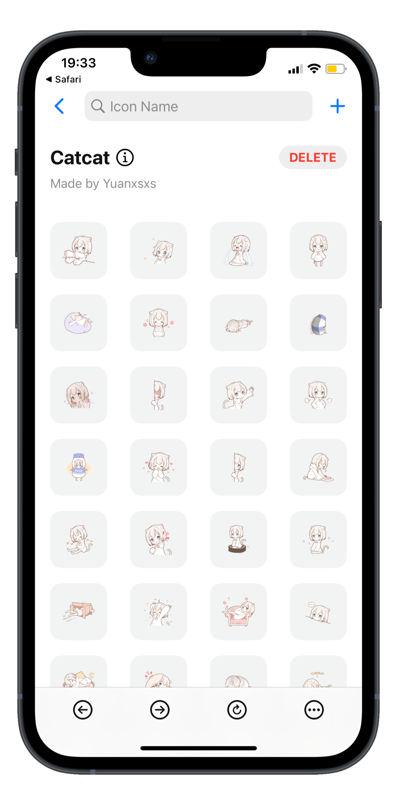
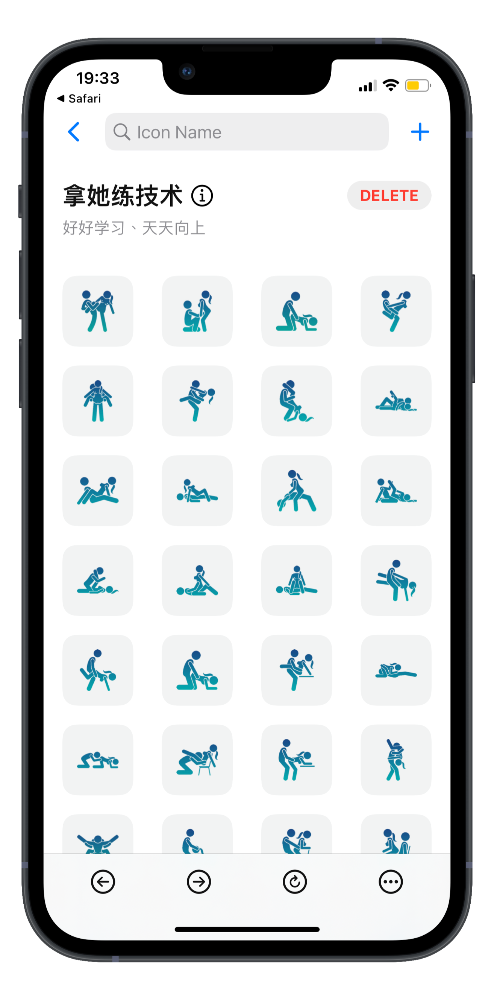

## 📋 GeoIP 库直链

点代码框右上角的复制按钮，粘贴到 Egern 的 GeoIP 数据库设置里：

```
https://raw.githubusercontent.com/YuTalk/tool/main/GeoIpCN.mmdb
```

---

> ⚠️ 仅自用

# 🧰 Tool

> 中国常用域名与中国 IPv4 地址库，让国内流量走国内、走直连，更快、更省电。


## 👀 一眼看懂

| 项目 | 数量 |
| --- | --- |
| 规则集 | 13 个（Egern、QX、Loon 各一份，内容一致） |
| 模块 | 3 个（Spotify、YouTube Enhance、哔哩哔哩，都是从别人家搬过来的原版，没改过） |
| 图标 | 13 个（13 套图标库的预览图，都是从别人家搬过来的原图） |
| 域名总数 | 964 条（去重后） |
| GeoIP 库 | 6,575 条 CIDR，约 132KB，覆盖 357,427,495 个中国 IPv4 地址 |
| 自动检查 | 每 6 小时，0:00、6:00、12:00、18:00 |

## 📖 目录

- [📦 文件说明](#-文件说明)
- [🧩 模块](#-模块)
- [⚡ 一键添加进软件](#-一键添加进软件)
- [🚀 怎么用](#-怎么用)
- [🔄 自动更新](#-自动更新)
- [❓ 常见问题](#-常见问题)
- [🔗 相关网站](#-相关网站)

---

## 📦 文件说明

### 🌐 规则集

| 规则 | 条数 | 说明 | 策略 |
| --- | --- | --- | --- |
| China | 664 | 国内应用 / 网站 + CDN / 后台，Egern DNS 转发 → 国内 | DIRECT |
| Google | 31 | 谷歌搜索、Gmail、YouTube 等 | 谷歌服务 |
| GoogleAds | 24 | 谷歌广告、统计、分析 | reject |
| Apple | 22 | 苹果系统、商店、iCloud | direct |
| Microsoft | 21 | Outlook、微软账号 | 微软服务 |
| SausageMan | 15 | 香肠派对及 TapTap 相关 | direct |
| AI_Part | 45 | Muse、GPT、Claude | 人工智能 |
| Spotify | 30 | Spotify 音乐及 CDN | Spotify |
| TikTok | 37 | 抖音国际版 TikTok 及剪映 | TikTok |
| GitHub | 31 | GitHub 及 npm 等 | GitHub |
| Speedtest | 9 | 测速（Speedtest、fast.com 等） | SpeedTest |
| Telegram | 35 | Telegram 及第三方客户端 | Telegram |
| GeoIP_CN | 1 | 中国 IP 段 | direct |

每套规则现在都放在自己的文件夹里（比如 `rule/egern/China/`），点进文件夹能看到这套规则的说明页，里面有这套规则是干什么的、多少条、怎么用和链接。

另外还有一份 Loon 版，在 `rule/loon/` 文件夹里，13 套内容和上面一模一样，只是格式换成 Loon 的 `DOMAIN-SUFFIX,域名,策略`，策略只有三种：DIRECT（China、Apple、SausageMan、GeoIP_CN）、PROXY（Google、Microsoft、AI_Part、Spotify、TikTok、GitHub、Speedtest、Telegram）、REJECT（GoogleAds）。

China.yaml 分两段，第一段是应用 / 网站域名 **530 条**，第二段是 CDN / 后台 / 接口域名 **134 条**，覆盖微信、QQ、淘宝、京东、拼多多、美团、饿了么、抖音、哔哩哔哩、爱奇艺、优酷、知乎、微博、百度、阿里、12306、银行、运营商、政府、快递……还有红果短剧、豆包、DeepSeek、Kimi、腾讯元宝、即梦 AI、剪映、夸克等热门应用。

为什么分两段？第一段是你平时打开的 App 和网站本身，第二段是这些 App 背后用的图片、视频、接口服务器。只加第一段的话，App 能打开，但里面的图片视频可能还是走外国 IP，又慢又卡；两段一起加才完整。

<details>
<summary>China 都包括谁？点开看</summary>

微信、QQ、淘宝、天猫、京东、拼多多、美团、饿了么、抖音、快手、哔哩哔哩、爱奇艺、优酷、腾讯视频、芒果 TV、知乎、微博、百度、阿里云、12306、携程、滴滴、高德地图、银行、运营商、政府网站、快递，等等。

</details>

<details>
<summary>AI_Part 都包括谁？点开看</summary>

- GPT / OpenAI（19 条）：ChatGPT 聊天、Sora 视频、OpenAI 官网、API 接口等
- Claude / Anthropic（19 条）：Claude 聊天、Claude 官网、App 等
- Muse / Meta AI（7 条）：meta.ai、muse.ai、llama.com 等，Meta 的 AI 聊天

三个 AI 都在国外，都要走代理。meta.com 故意没加，因为它会把 Facebook、Instagram、WhatsApp 也拉进来。

</details>

<details>
<summary>每条规则是干什么的？点开看</summary>

- **China（664 条）**：国内常用的应用和网站域名，加上它们的 CDN、后台、接口域名。分两段：第一段是应用和网站本身（530 条），第二段是这些应用背后的 CDN、图片、视频、接口域名（134 条），两段要一起用才完整。Egern 里要加两处：DNS 转发 → 国内，查域名时问国内 DNS，拿到国内 IP；分流 → DIRECT，流量直接走，不绕代理。这样国内 App 打开快、不卡，视频图片也快。
- **Google（31 条）**：谷歌全家桶，谷歌搜索、Gmail、YouTube、Google Drive、Google 地图、Google Play、谷歌账号登录等。谷歌在国内打不开，必须走代理，策略选谷歌服务（也就是你的代理节点组）。
- **GoogleAds（24 条）**：谷歌的广告、统计、分析和崩溃上报域名，比如 doubleclick、adsense、firebase、crashlytics。走 reject 直接拦截，不让它们上报和弹广告，App 打开更快，也少耗流量。
- **Apple（22 条）**：苹果系统服务，App Store、iCloud、Apple ID、系统更新、推送通知、Siri、Apple Music 等。苹果的服务器在国内有节点，走直连最快最稳，分流 → DIRECT，DNS 也走国内。
- **Microsoft（21 条）**：微软服务，Outlook 邮箱、微软账号登录、OneDrive、Office 等。微软的服务器在国外，走直连慢甚至打不开，要走代理，策略选微软服务。
- **SausageMan（15 条）**：香肠派对（吃鸡手游）加 TapTap 相关域名，游戏服务器、TapTap 下载、TapTap 账号、游戏内嵌网页等。游戏服务器在国内，走直连延迟最低，分流 → DIRECT，DNS 转发 → 国内。
- **AI_Part（45 条）**：只包括你常用的三个 AI，Muse（Meta AI，7 条）、GPT / ChatGPT（OpenAI，19 条）、Claude（Anthropic，19 条）。三个 AI 都在国外，必须走代理，策略选人工智能。注意：meta.com 没加进去，因为它太宽，会把 Facebook、Instagram、WhatsApp 也拉进 AI 组。
- **Spotify（30 条）**：Spotify 音乐，官网、App、歌单、歌词、图片和音频 CDN（spotifycdn、scdn、pscdn、akamaized、fastly）。Spotify 在国内打不开，必须走代理，策略选 Spotify。
- **TikTok（37 条）**：抖音国际版 TikTok，App、视频 CDN、直播、剪映 CapCut、Trae AI 编程等。都在国外，必须走代理，策略选 TikTok。其中 ttwstatic.com 和 tiktokcdn 关键词是从 fmz200 的上游同步来的。
- **GitHub（31 条）**：GitHub 全家，github.com、raw.githubusercontent.com、github.io、ghcr.io、githubassets、npmjs、git.io 等。GitHub 在国内直连慢，走代理最稳，策略选 GitHub。
- **Speedtest（9 条）**：测速网站，speedtest.net、fast.com、ooklaserver、speed.cloudflare.com 等。测速要走代理才能测出真实的节点速度，策略选 SpeedTest。
- **Telegram（35 条）**：Telegram，官网、t.me、telegra.ph、telegram.org、下载和 CDN，还有 Telegram 的服务器 IP 段（149.154.160.0/20、91.108.0.0/16 等）。Telegram 在国内打不开，必须走代理，策略选 Telegram。
- **GeoIP_CN（1 条）**：中国 IP 段列表，只有 1 条规则，内容就是 geoip, cn, direct，Egern、QX、Loon 三个版本都有。QX 没有自建 .mmdb 库，靠这条远程规则判断中国 IP。放在分流倒数第二，外国 IP 走默认代理。

</details>

### 🖼️ 图标

图标都放在顶层 `icon/` 文件夹里，都是从别人家搬过来的原图（主要来自 [ddgksf2013/Icon](https://github.com/ddgksf2013/Icon) 和 [Koolson/Qure](https://github.com/Koolson/Qure)）。文件夹里现在只有 13 张预览图（preview-01 到 preview-13），单个应用图标已经删了，只留预览图给你看效果。

**13 套图标库（预览图就是原图，点图片可以放大看）：**

蓝色按钮直接加进 QX，点了就跳进 QX 问你要不要添加。绿色按钮是 Egern 的，Egern 没有一键导入图标的功能，点了打开的是图标集 JSON 链接，复制链接后去 Egern 的图标库里粘贴添加。

五组风格：Qure 系列是简洁线条风（黑白、彩色、mini 三种）；Orz-3 系列是圆润彩色风；卡通可爱组是泡泡、宝可梦、小猫咪；姿势组是人物姿势图标；手绘组是 Semporia 的手绘风。

#### Qure 系列

**Qure 图标库（黑白）** [](https://quantumult.app/x/open-app/ui?module=gallery&type=icon&action=add&content=%5B%0A%20%20%20%20%22https%3A%2F%2Fgithub.com%2FKoolson%2FQure%2Fraw%2Fmaster%2FOther%2FQureLight-All.json%22%0A%5D) [](https://raw.githubusercontent.com/Koolson/Qure/master/Other/QureLight-All.json)

<a href="https://raw.githubusercontent.com/YuTalk/tool/main/icon/preview-01-qure-light.PNG"></a>

**Qure 图标库（彩色 1）** [](https://quantumult.app/x/open-app/ui?module=gallery&type=icon&action=add&content=%5B%0A%20%20%20%20%22https%3A%2F%2Fgithub.com%2FKoolson%2FQure%2Fraw%2Fmaster%2FOther%2FQureColor-All.json%22%0A%5D) [](https://raw.githubusercontent.com/Koolson/Qure/master/Other/QureColor-All.json)

<a href="https://raw.githubusercontent.com/YuTalk/tool/main/icon/preview-02-qure-color-all.PNG"></a>

**Qure 图标库（彩色 2）** [](https://quantumult.app/x/open-app/ui?module=gallery&type=icon&action=add&content=%5B%0A%20%20%20%20%22https%3A%2F%2Fraw.githubusercontent.com%2FKoolson%2FQure%2Fmaster%2FOther%2FQureColor.json%22%0A%5D) [](https://raw.githubusercontent.com/Koolson/Qure/master/Other/QureColor.json)

<a href="https://raw.githubusercontent.com/YuTalk/tool/main/icon/preview-03-qure-color.PNG"></a>

**Qure 图标（mini）** [](https://quantumult.app/x/open-app/ui?module=gallery&type=icon&action=add&content=%5B%0A%20%20%20%20%22https%3A%2F%2Fraw.githubusercontent.com%2FKoolson%2FQure%2Fmaster%2FOther%2FQuremini.json%22%0A%5D) [](https://raw.githubusercontent.com/Koolson/Qure/master/Other/Quremini.json)

<a href="https://raw.githubusercontent.com/YuTalk/tool/main/icon/preview-04-qure-mini.PNG"></a>

#### Orz-3 系列

**Orz-3 图标库（mini style）** [](https://quantumult.app/x/open-app/ui?module=gallery&type=icon&action=add&content=%5B%0A%20%20%20%20%22https%3A%2F%2Fgithub.com%2FOrz-3%2Fmini%2Fraw%2Fmaster%2Fmini.json%22%0A%5D) [](https://raw.githubusercontent.com/Orz-3/mini/master/mini.json)

<a href="https://raw.githubusercontent.com/YuTalk/tool/main/icon/preview-05-orz3-mini.PNG"></a>

**Orz-3 图标库（big style）** [](https://quantumult.app/x/open-app/ui?module=gallery&type=icon&action=add&content=%5B%0A%20%20%20%20%22https%3A%2F%2Fraw.githubusercontent.com%2FOrz-3%2Fmini%2Fmaster%2FColor%2B.json%22%0A%5D) [](https://raw.githubusercontent.com/Orz-3/mini/master/Color+.json)

<a href="https://raw.githubusercontent.com/YuTalk/tool/main/icon/preview-06-orz3-big.PNG"></a>

**Orz-3 图标库（mini color）** [](https://quantumult.app/x/open-app/ui?module=gallery&type=icon&action=add&content=%5B%0A%20%20%20%20%22https%3A%2F%2Fraw.githubusercontent.com%2FOrz-3%2Fmini%2Fmaster%2FminiColor.json%22%0A%5D) [](https://raw.githubusercontent.com/Orz-3/mini/master/miniColor.json)

<a href="https://raw.githubusercontent.com/YuTalk/tool/main/icon/preview-07-orz3-mini-color.PNG"></a>

#### 卡通可爱

**泡泡图标** [](https://quantumult.app/x/open-app/ui?module=gallery&type=icon&action=add&content=%5B%0A%20%20%20%20%22https%3A%2F%2Fraw.githubusercontent.com%2Ftugepaopao%2FImage-Storage%2Fmaster%2Fother%2FCute.json%22%0A%5D) [](https://raw.githubusercontent.com/tugepaopao/Image-Storage/master/other/Cute.json)

<a href="https://raw.githubusercontent.com/YuTalk/tool/main/icon/preview-08-cute.PNG"></a>

**PokemonGo** [](https://quantumult.app/x/open-app/ui?module=gallery&type=icon&action=add&content=%5B%0A%20%20%20%20%22https%3A%2F%2Fraw.githubusercontent.com%2Fshoujiqiyuan%2FPokemonGOforQuanX%2Fmaster%2FPokemonGo.json%22%0A%5D) [](https://raw.githubusercontent.com/shoujiqiyuan/PokemonGOforQuanX/master/PokemonGo.json)

<a href="https://raw.githubusercontent.com/YuTalk/tool/main/icon/preview-09-pokemongo.PNG"></a>

**小猫咪** [](https://quantumult.app/x/open-app/ui?module=gallery&type=icon&action=add&content=%5B%0A%20%20%20%20%22https%3A%2F%2Fraw.githubusercontent.com%2FYuanxsxs%2FQtumultX%2Fmaster%2FIcon%2FCatcat.json%22%0A%5D) [](https://raw.githubusercontent.com/Yuanxsxs/QtumultX/master/Icon/Catcat.json)

<a href="https://raw.githubusercontent.com/YuTalk/tool/main/icon/preview-10-catcat.PNG"></a>

#### 姿势

**姿势图标 1** [](https://quantumult.app/x/open-app/ui?module=gallery&type=icon&action=add&content=%5B%0A%20%20%20%20%22https%3A%2F%2Fgithub.com%2FLovedGM%2FQuantumult-X-TuBiao%2Fraw%2Fmain%2Fzishi.json%22%0A%5D) [](https://raw.githubusercontent.com/LovedGM/Quantumult-X-TuBiao/main/zishi.json)

<a href="https://raw.githubusercontent.com/YuTalk/tool/main/icon/preview-11-zishi.PNG"></a>

**姿势图标 2** [](https://quantumult.app/x/open-app/ui?module=gallery&type=icon&action=add&content=%5B%0A%20%20%20%20%22https%3A%2F%2Fraw.githubusercontent.com%2FLovedGM%2FQuantumult-X-TuBiao%2Fmain%2Fzishi-cs.json%22%0A%5D) [](https://raw.githubusercontent.com/LovedGM/Quantumult-X-TuBiao/main/zishi-cs.json)

<a href="https://raw.githubusercontent.com/YuTalk/tool/main/icon/preview-12-zishi-cs.PNG"></a>

#### 手绘

**Semporia** [](https://quantumult.app/x/open-app/ui?module=gallery&type=icon&action=add&content=%5B%0A%20%20%20%20%22https%3A%2F%2Fraw.githubusercontent.com%2FSemporia%2FHand-Painted-icon%2Fmaster%2FSemporia.json%22%0A%5D) [](https://raw.githubusercontent.com/Semporia/Hand-Painted-icon/master/Semporia.json)

<a href="https://raw.githubusercontent.com/YuTalk/tool/main/icon/preview-13-semporia.PNG"></a>

### GeoIpCN.mmdb（6,575 条 CIDR，约 132KB）

只含中国 IPv4，共覆盖 **357,427,495 个地址**，约 132KB，纯 IPv4，不含 IPv6。

这是干什么的？代理软件拿到一个 IP 地址后，要判断这个 IP 是中国的还是外国的，才能决定走直连还是走代理，这个判断就靠 GeoIP 库。库里只装了中国段，外国 IP 查不到中国，返回空，就走代理；中国 IP 查得到，就走直连。所以库里没有外国段是正常的，不是缺数据。

数据来源（5 个来源合并去重，每个来源单独拿出来都不全，合起来才全）：

- 17mon/china_ip_list：国内常用的中国 IP 列表
- APNIC 中国分配数据（cn|ipv4）：亚太互联网络信息中心分配给中国的 IP 段，最权威
- chnroutes2：开源的中国路由表
- Loyalsoldier/geoip CN 文本（仅 IPv4）：Loyalsoldier 维护的中国 IP 文本
- metowolf/iplist 纯真 CN：纯真 IP 库的中国段

怎么验证？223.5.5.5（阿里 DNS）、119.29.29.29（腾讯 DNS）、114.114.114.114 查出来必须是 CN；8.8.8.8（谷歌 DNS）、1.1.1.1 查出来必须不是 CN。

> 只含中国段，外国 IP 查不到中国，这是对的 —— GEOIP CN 才能把外国流量送去代理。

---

## 🧩 模块

3 个模块，都是从别人家直接搬过来的原版文件，内容一个字都没改过。上游更新了，这里每 6 小时自动同步一次。

| 模块 | 是干什么的 | 原作者 |
| --- | --- | --- |
| Spotify | 会员配置、首页与播放页去广告，歌词补全和双语翻译 | Reukix |
| YouTube Enhance | YouTube 和 YouTube Music 增强，屏蔽上传、选段、Shorts 按钮，字幕翻译 | Maasea |
| 哔哩哔哩 | 哔哩哔哩去广告 | fmz200 |

怎么用：Egern 里工具 → 模块 → 点 +，粘贴下面对应模块的链接；QX 里直接加远程模块链接。

- Spotify：`https://raw.githubusercontent.com/YuTalk/tool/main/module/Spotify/Spotify.sgmodule`
- YouTube Enhance：`https://raw.githubusercontent.com/YuTalk/tool/main/module/YouTube.Enhance/YouTube.Enhance.sgmodule`
- 哔哩哔哩：`https://raw.githubusercontent.com/YuTalk/tool/main/module/bilibili/bilibili.yaml`

---

## ⚡ 一键添加进软件

点下面表格里的链接，就会直接跳进 Egern / QX，问你要不要添加，点确认就加进去了，不用自己复制链接再粘贴。

| 软件 | Egern | Quantumult X |
| --- | --- | --- |
| China | [](https://egernapp.com/rules/new?type=rule_set&match=https%3A%2F%2Fraw.githubusercontent.com%2FYuTalk%2Ftool%2Fmain%2Frule%2Fegern%2FChina%2FChina.yaml&policy=DIRECT) | [](https://quantumult.app/x/open-app/add-resource?remote-resource=%7B%22filter_remote%22%3A%5B%22https%3A%2F%2Fraw.githubusercontent.com%2FYuTalk%2Ftool%2Fmain%2Frule%2Fquantumultx%2FChina%2FChina.list%2C%20tag%3DChina%2C%20force-policy%3Ddirect%22%5D%7D) |
| Google | [](https://egernapp.com/rules/new?type=rule_set&match=https%3A%2F%2Fraw.githubusercontent.com%2FYuTalk%2Ftool%2Fmain%2Frule%2Fegern%2FGoogle%2FGoogle.yaml&policy=%E8%B0%B7%E6%AD%8C%E6%9C%8D%E5%8A%A1) | [](https://quantumult.app/x/open-app/add-resource?remote-resource=%7B%22filter_remote%22%3A%5B%22https%3A%2F%2Fraw.githubusercontent.com%2FYuTalk%2Ftool%2Fmain%2Frule%2Fquantumultx%2FGoogle%2FGoogle.list%2C%20tag%3DGoogle%2C%20force-policy%3D%E8%B0%B7%E6%AD%8C%E6%9C%8D%E5%8A%A1%22%5D%7D) |
| GoogleAds | [](https://egernapp.com/rules/new?type=rule_set&match=https%3A%2F%2Fraw.githubusercontent.com%2FYuTalk%2Ftool%2Fmain%2Frule%2Fegern%2FGoogleAds%2FGoogleAds.yaml&policy=REJECT) | [](https://quantumult.app/x/open-app/add-resource?remote-resource=%7B%22filter_remote%22%3A%5B%22https%3A%2F%2Fraw.githubusercontent.com%2FYuTalk%2Ftool%2Fmain%2Frule%2Fquantumultx%2FGoogleAds%2FGoogleAds.list%2C%20tag%3DGoogleAds%2C%20force-policy%3Dreject%22%5D%7D) |
| Apple | [](https://egernapp.com/rules/new?type=rule_set&match=https%3A%2F%2Fraw.githubusercontent.com%2FYuTalk%2Ftool%2Fmain%2Frule%2Fegern%2FApple%2FApple.yaml&policy=DIRECT) | [](https://quantumult.app/x/open-app/add-resource?remote-resource=%7B%22filter_remote%22%3A%5B%22https%3A%2F%2Fraw.githubusercontent.com%2FYuTalk%2Ftool%2Fmain%2Frule%2Fquantumultx%2FApple%2FApple.list%2C%20tag%3DApple%2C%20force-policy%3Ddirect%22%5D%7D) |
| Microsoft | [](https://egernapp.com/rules/new?type=rule_set&match=https%3A%2F%2Fraw.githubusercontent.com%2FYuTalk%2Ftool%2Fmain%2Frule%2Fegern%2FMicrosoft%2FMicrosoft.yaml&policy=%E5%BE%AE%E8%BD%AF%E6%9C%8D%E5%8A%A1) | [](https://quantumult.app/x/open-app/add-resource?remote-resource=%7B%22filter_remote%22%3A%5B%22https%3A%2F%2Fraw.githubusercontent.com%2FYuTalk%2Ftool%2Fmain%2Frule%2Fquantumultx%2FMicrosoft%2FMicrosoft.list%2C%20tag%3DMicrosoft%2C%20force-policy%3D%E5%BE%AE%E8%BD%AF%E6%9C%8D%E5%8A%A1%22%5D%7D) |
| SausageMan | [](https://egernapp.com/rules/new?type=rule_set&match=https%3A%2F%2Fraw.githubusercontent.com%2FYuTalk%2Ftool%2Fmain%2Frule%2Fegern%2FSausageMan%2FSausageMan.yaml&policy=DIRECT) | [](https://quantumult.app/x/open-app/add-resource?remote-resource=%7B%22filter_remote%22%3A%5B%22https%3A%2F%2Fraw.githubusercontent.com%2FYuTalk%2Ftool%2Fmain%2Frule%2Fquantumultx%2FSausageMan%2FSausageMan.list%2C%20tag%3DSausageMan%2C%20force-policy%3Ddirect%22%5D%7D) |
| AI_Part | [](https://egernapp.com/rules/new?type=rule_set&match=https%3A%2F%2Fraw.githubusercontent.com%2FYuTalk%2Ftool%2Fmain%2Frule%2Fegern%2FAI_Part%2FAI_Part.yaml&policy=%E4%BA%BA%E5%B7%A5%E6%99%BA%E8%83%BD) | [](https://quantumult.app/x/open-app/add-resource?remote-resource=%7B%22filter_remote%22%3A%5B%22https%3A%2F%2Fraw.githubusercontent.com%2FYuTalk%2Ftool%2Fmain%2Frule%2Fquantumultx%2FAI_Part%2FAI_Part.list%2C%20tag%3DAI_Part%2C%20force-policy%3D%E4%BA%BA%E5%B7%A5%E6%99%BA%E8%83%BD%22%5D%7D) |
| Spotify | [](https://egernapp.com/rules/new?type=rule_set&match=https%3A%2F%2Fraw.githubusercontent.com%2FYuTalk%2Ftool%2Fmain%2Frule%2Fegern%2FSpotify%2FSpotify.yaml&policy=Spotify) | [](https://quantumult.app/x/open-app/add-resource?remote-resource=%7B%22filter_remote%22%3A%5B%22https%3A%2F%2Fraw.githubusercontent.com%2FYuTalk%2Ftool%2Fmain%2Frule%2Fquantumultx%2FSpotify%2FSpotify.list%2C%20tag%3DSpotify%2C%20force-policy%3DSpotify%22%5D%7D) |
| TikTok | [](https://egernapp.com/rules/new?type=rule_set&match=https%3A%2F%2Fraw.githubusercontent.com%2FYuTalk%2Ftool%2Fmain%2Frule%2Fegern%2FTikTok%2FTikTok.yaml&policy=TikTok) | [](https://quantumult.app/x/open-app/add-resource?remote-resource=%7B%22filter_remote%22%3A%5B%22https%3A%2F%2Fraw.githubusercontent.com%2FYuTalk%2Ftool%2Fmain%2Frule%2Fquantumultx%2FTikTok%2FTikTok.list%2C%20tag%3DTikTok%2C%20force-policy%3DTikTok%22%5D%7D) |
| GitHub | [](https://egernapp.com/rules/new?type=rule_set&match=https%3A%2F%2Fraw.githubusercontent.com%2FYuTalk%2Ftool%2Fmain%2Frule%2Fegern%2FGitHub%2FGitHub.yaml&policy=GitHub) | [](https://quantumult.app/x/open-app/add-resource?remote-resource=%7B%22filter_remote%22%3A%5B%22https%3A%2F%2Fraw.githubusercontent.com%2FYuTalk%2Ftool%2Fmain%2Frule%2Fquantumultx%2FGitHub%2FGitHub.list%2C%20tag%3DGitHub%2C%20force-policy%3DGitHub%22%5D%7D) |
| Speedtest | [](https://egernapp.com/rules/new?type=rule_set&match=https%3A%2F%2Fraw.githubusercontent.com%2FYuTalk%2Ftool%2Fmain%2Frule%2Fegern%2FSpeedtest%2FSpeedtest.yaml&policy=SpeedTest) | [](https://quantumult.app/x/open-app/add-resource?remote-resource=%7B%22filter_remote%22%3A%5B%22https%3A%2F%2Fraw.githubusercontent.com%2FYuTalk%2Ftool%2Fmain%2Frule%2Fquantumultx%2FSpeedtest%2FSpeedtest.list%2C%20tag%3DSpeedtest%2C%20force-policy%3DSpeedTest%22%5D%7D) |
| Telegram | [](https://egernapp.com/rules/new?type=rule_set&match=https%3A%2F%2Fraw.githubusercontent.com%2FYuTalk%2Ftool%2Fmain%2Frule%2Fegern%2FTelegram%2FTelegram.yaml&policy=Telegram) | [](https://quantumult.app/x/open-app/add-resource?remote-resource=%7B%22filter_remote%22%3A%5B%22https%3A%2F%2Fraw.githubusercontent.com%2FYuTalk%2Ftool%2Fmain%2Frule%2Fquantumultx%2FTelegram%2FTelegram.list%2C%20tag%3DTelegram%2C%20force-policy%3DTelegram%22%5D%7D) |
| GeoIP_CN | [](https://egernapp.com/rules/new?type=rule_set&match=https%3A%2F%2Fraw.githubusercontent.com%2FYuTalk%2Ftool%2Fmain%2Frule%2Fegern%2FGeoIP_CN%2FGeoIP_CN.yaml&policy=DIRECT) | [](https://quantumult.app/x/open-app/add-resource?remote-resource=%7B%22filter_remote%22%3A%5B%22https%3A%2F%2Fraw.githubusercontent.com%2FYuTalk%2Ftool%2Fmain%2Frule%2Fquantumultx%2FGeoIP_CN%2FGeoIP_CN.list%2C%20tag%3DGeoIP_CN%2C%20force-policy%3Ddirect%22%5D%7D) |

> 注意：
> - Egern 的一键添加是加到**分流**里，China 还要再单独加一次 **DNS 转发 → 国内**，那个不能一键加，得在设置里手动加。
> - 点链接后软件会先弹出来让你确认，策略已经按上面表格填好了，确认就行。
> - 如果点链接没反应，先确认 Egern / QX 已经装好了。

---

## 🚀 怎么用

### 🐿️ Egern

1. **DNS 转发**：设置 → DNS 转发 → 添加规则集，粘贴 China 的链接，策略选国内。

   ```
   https://raw.githubusercontent.com/YuTalk/tool/main/rule/egern/China/China.yaml
   ```

   DNS 转发是查域名用的：国内域名问国内 DNS，拿到国内 IP；国外域名问国外 DNS。只加 China 就够了，其他规则不用加 DNS 转发。
2. **分流**：设置 → 分流 → 添加规则集，粘贴对应链接，策略按上面表格选。分流是决定流量走哪条路的：China、Apple、SausageMan 走 DIRECT 直连；Google、Microsoft、AI_Part 走代理节点组；GoogleAds 走 reject 拦截。也可以直接点上面「一键添加」表格里的绿色按钮，不用自己复制链接。
3. **GeoIP 库**：设置 → GeoIP 数据库 → 粘贴 GeoIpCN.mmdb 的链接，把默认的库换成这个自建库。

   ```
   https://raw.githubusercontent.com/YuTalk/tool/main/GeoIpCN.mmdb
   ```

   自建库只含中国段，判断更准。
4. **分流留一条**：`GEOIP CN → DIRECT` 放倒数第二，`默认 → 兜底策略` 放最后。倒数第二的意思是：前面所有域名规则都没匹配上，才轮到 GEOIP 判断 IP 是不是中国的；是中国的走直连，不是的走默认代理。

> ⚠️ GEOIP CN 一定放倒数第二，别放第一，不然每个域名都要先解析 IP，费电又变慢。域名规则不用查 IP，直接按域名匹配，又快又省电，只有没匹配上的流量才需要查 IP。

### ⚡ Quantumult X

1. 分流里加远程规则，粘贴上面表格里的 QX 版链接，策略按表格选。也可以直接点表格里的蓝色按钮，会跳进 QX 问你要不要添加。
2. 分流留一条：`geoip, cn, direct` 放倒数第二，`final` 放最后。QX 没有自建 .mmdb 库，靠 GeoIP_CN.list 这条远程规则判断中国 IP。
3. QX 不能用自建 .mmdb 库，用它自带的就行。QX 也没有 DNS 转发功能，DNS 就靠分流本身，国内域名走直连、国外走代理，效果是一样的。
4. 注意：QX 每条规则后面必须带策略，没有策略会报 Invalid Line，这个仓库的 QX 版每条都带了策略，直接用就行。

### 🟢 Loon

1. 分流里加远程规则，粘贴 `rule/loon/` 文件夹里对应那套的 `.list` 链接，每条规则自带策略，不用自己选：China、Apple、SausageMan、GeoIP_CN 是 DIRECT，Google、Microsoft、AI_Part、Spotify、TikTok、GitHub、Speedtest、Telegram 是 PROXY，GoogleAds 是 REJECT。
2. 分流留一条：`GEOIP,CN,DIRECT` 放倒数第二，`FINAL,兜底后备策略` 放最后。Loon 没有自建 .mmdb 库，靠 GeoIP_CN.list 这条远程规则判断中国 IP。
3. Loon 的 DoH 流量模式选 Rule，就相当于 Egern 的 DNS 转发，国内域名走国内 DNS，国外走国外 DNS。
4. 哔哩哔哩模块 Loon 不能直接用仓库里那个 Egern 版（`.yaml`），要用作者的 Loon 版插件（`.lpx`），链接在上面「模块」那节的说明里。

---

## 🔄 自动更新

| 任务 | 频率 |
| --- | --- |
| 仓库检查（全部规则 + GeoIP 库 + 模块 + README） | 每 6 小时，0:00、6:00、12:00、18:00 |

每次检查做五件事：

1. **规则**：China 从 ChinaDomain.list 和 geolocation-cn.yaml 拉最新源，合并去重；其他 6 套检查有没有失效域名（已停用、无法解析、服务已下线）。Egern 版和 QX 版同步改。
2. **GeoIP 库**：从 5 个来源拉最新 IP 段，合并去重后重建 GeoIpCN.mmdb，验证通过才推。
3. **模块**：Spotify、YouTube Enhance、哔哩哔哩从上游原地址拉最新版，原样同步，不改内容。
4. **README**：检查里面的链接和条数是不是还对得上仓库现状，对不上就改对。
5. **图标**：13 张预览图都在不在，链接能不能打开。

文件名和链接固定不变，只更新内容。新增域名要经过主人同意才加，失效的直接删。每次有变化都会发邮件通知，没变化就不发。

---

## ❓ 常见问题

**Q：外国网站会不会被误判成中国？**
A：不会。库里只装了中国段，外国 IP 查不到，返回空，就走代理。只有中国 IP 才会走直连。

**Q：为什么只有 IPv4？**
A：IPv6 关着，用纯 IPv4 更小更快。以后开 IPv6 再换回带 IPv6 的库。

**Q：China.yaml 里的 CDN 域名有什么用？**
A：主域名和 CDN 要一起走国内 DNS，不然图片视频会回外国 IP，慢甚至打不开。比如打开淘宝，主域名 taobao.com 走国内 DNS 拿到国内 IP，但商品图片在 CDN 上，如果 CDN 域名没加，图片就可能问国外 DNS 拿到外国 IP，图片加载慢甚至打不开。

**Q：Egern 和 QX 的文件有什么区别？**
A：内容一样，只是格式不同：Egern 用 `.yaml`，QX 用 `.list`，QX 每条后面都带策略。Egern 版和 QX 版是同步更新的，改一边另一边也会改。

**Q：为什么 GEOIP CN 要放倒数第二，不能放第一？**
A：放第一的话，每个域名都要先查 DNS 拿到 IP 再判断，费电又变慢。放倒数第二，域名规则先按域名匹配，不用查 IP，只有前面都没匹配上的流量才查 IP 判断，又快又省电。

**Q：DNS 转发和分流有什么区别？**
A：DNS 转发是查域名的时候决定问哪个 DNS（国内域名问国内 DNS，国外问国外 DNS），分流是拿到 IP 后决定流量走直连还是走代理。两个都要配，缺一个效果就打折：只配分流不配 DNS 转发，国内域名可能问国外 DNS 拿到外国 IP，GEOIP 判断就错了；只配 DNS 转发不配分流，流量不知道走哪条路。

**Q：规则集显示 0 条怎么办？**
A：先看链接对不对，再点规则集手动刷新一次。Egern 是按内容解析的，后缀不重要；如果刷新后还是 0，可能是链接里的文件被删了或者网络问题，等一会儿再试。

**Q：怎么知道规则有没有生效？**
A：打开 Egern 的连接记录，看域名的连接走的是哪条策略。比如打开微信，看 weixin.qq.com 是不是走 DIRECT；打开 YouTube，看 youtube.com 是不是走代理。

**Q：图标预览图怎么放大看？**
A：点图片就能打开原图，再捏合放大。图标那节的 13 张预览图都是原图，点开看得更清楚。

**Q：Egern 消息储存是什么？**
A：平时用 Egern 攒下来的笔记（比如域名匹配的 5 种写法），存在一个单独的网页上，仓库最下面「Egern 消息储存」那节有链接，点链接就能看。网页上能新增、改、删、置顶、收藏，还能自己加分类；默认只能看，站长用口令解锁后才能改。

---

## 📄 开源协议

MIT License —— 随便用，改了也行。

---

## 🔗 相关网站

平时找模块、规则用得上的几个站：

| 网站 | 是干什么的 |
| --- | --- |
| [Egern Hub](https://egern.pages.dev) | Egern 官方站，模块、规则与文档 |
| [松果库](https://nutrepo.com) | Egern、Surge、Loon、QX、Stash 的模块中心 |
| [yfamily](https://yfamilys.com) | 代理工具的配置、模块、插件与分流规则 |
| [ios_rule_script](https://github.com/blackmatrix7/ios_rule_script/tree/master) | blackmatrix7 的 iOS 规则库，本仓库 5 套规则的上游 |
| [wool_scripts](https://github.com/fmz200/wool_scripts) | fmz200 的规则与模块库，本仓库哔哩哔哩模块的上游 |
| [墨魚手記](https://ddgksf2013.top) | 个人资源索引：影视、动漫、下载、工具、QX 脚本 |

---

## 📝 Egern 消息储存

平时用 Egern 攒下来的笔记和提醒（比如域名匹配的 5 种写法），存在一个单独的网页上，能新增、改、删、置顶、收藏，还能自己加分类；默认只能看，站长用口令解锁后才能改。

[Egern 消息储存](https://yutalk.github.io/egern-notes/)

